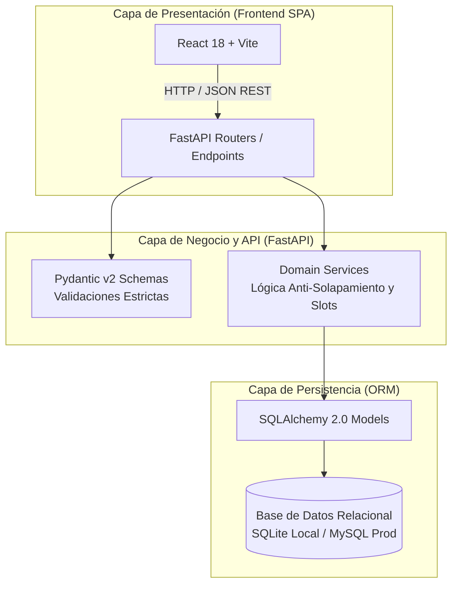
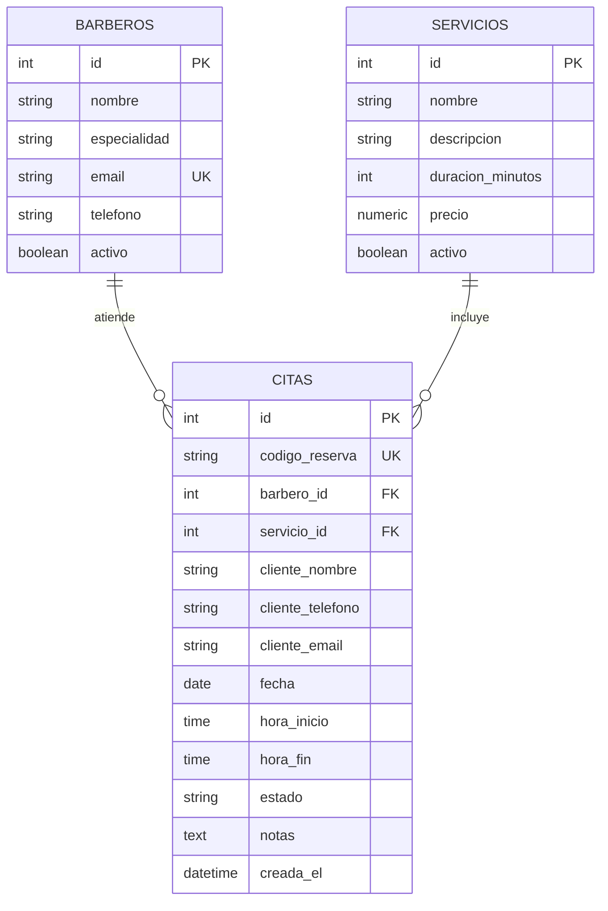

<<<<<<< HEAD
# BarberShop Pro 💈✂️
### Sistema Integral de Gestión de Barberías y Reserva de Citas

[](https://fastapi.tiangolo.com/)
[](https://www.python.org/)
[](https://www.sqlalchemy.org/)
[](https://docs.pydantic.dev/)
[](https://react.dev/)
[](#)

---

## 📌 1. Presentación Institucional y Equipo de Proyecto

**BarberShop Pro** es una plataforma de software desarrollada para la modernización, control operativo y gestión ágil de turnos para barberías profesionales. El proyecto se enmarca dentro de las buenas prácticas de ingeniería de software, arquitectura modular en capas, diseño orientado al dominio y control de calidad basado en desarrollo guiado por comportamiento (**BDD**).

- **Institución:** Corporación de Estudios Tecnológicos del Norte del Valle — Cotecnova  
- **Materia:** Ingeniería de Software II (Código 17934)  
- **Versión:** 1.0 (Seguimiento 1)  

### 👥 Equipo de Desarrollo y Roles

| Integrante | Rol Asignado | Responsabilidad Principal | Entregables Clave |
| :--- | :--- | :--- | :--- |
| **Elizabeth Ramirez** | *Líder Técnico & Backend Core* | Arquitectura del backend, modelos relacionales, persistencia en ORM y API REST en FastAPI. | `src/backend/`, modelos relacionales, migraciones y seed inicial. |
| **Juan David Monroy** | *Documentación & Requisitos Formales* | Especificación de requisitos formales (RF/RNF), historias de usuario con criterios Gherkin y manual de gestión ágil. | `README.md`, `docs/especificacion.md`, `docs/guia-trello.md`. |
| **Sebastian Orozco** | *Responsable de Pruebas & QA* | Diseño y ejecución de suites de pruebas automatizadas, casos de prueba (CP-01 a CP-09) y cobertura. | Pruebas funcionales y automatización de validaciones. |
| **Juan David Osorio** | *Responsable de Calidad & Mantenimiento* | Métricas de calidad, trazabilidad de defectos, auditoría de código y políticas de mantenimiento. | `docs/informe-calidad.md`, registro de defectos prevenidos. |

---

## 🚀 2. Visión y Objetivos del Sistema

El objetivo de **BarberShop Pro** es solucionar de forma automatizada las ineficiencias de agendamiento en salones de barbería:

1. **Agendamiento Inteligente sin Choques (Zero Overbooking)**: Algoritmo matemático estricto que evalúa en tiempo real colisiones entre franjas horarias:
   $$\max(\text{Inicio}_A, \text{Inicio}_B) < \min(\text{Fin}_A, \text{Fin}_B)$$
   Permitiendo citas consecutivas contiguas ($\text{Fin}_A = \text{Inicio}_B$) sin falsos positivos.
2. **Autogestión para Clientes**: Consulta dinámica de slots disponibles cada 30 minutos dentro del horario comercial (09:00 a 20:00).
3. **Trazabilidad Inmediata**: Generación de códigos únicos institucionales alfanuméricos con formato `BSP-XXXXXX`.
4. **Ciclo de Vida Controlado**: Gestión de estados (`Pendiente`, `En curso`, `Finalizada`, `Cancelada`) con inmutabilidad garantizada tras el cierre del servicio.

---

## 🏛️ 3. Arquitectura del Sistema

El proyecto adopta una **arquitectura desacoplada en capas (Separation of Concerns)**:



### 🗄️ Diagrama Entidad-Relación (DER)



---

## 🛠️ 4. Stack Tecnológico

- **Backend**: Python 3.10+, [FastAPI 0.110+](https://fastapi.tiangolo.com/), [Uvicorn](https://www.uvicorn.org/).
- **ORM & Persistencia**: [SQLAlchemy 2.0](https://www.sqlalchemy.org/) con soporte dual para SQLite (desarrollo local sin dependencias externas) y MySQL vía [PyMySQL](https://github.com/PyMySQL/PyMySQL).
- **Validación Estricta**: [Pydantic v2](https://docs.pydantic.dev/) con sanitización de texto y límites de dominio.
- **Frontend SPA**: React 18, Vite y Vanilla CSS (estructurado en `src/frontend`).
- **Pruebas y Calidad**: Pytest, Pytest-Asyncio, HTTPX.
- **Metodología y Gestión**: Kanban en Trello, especificación BDD con sintaxis Gherkin.

---

## 📂 5. Estructura del Repositorio

```plaintext
gestor-barberia/
├── .gitignore                     # Exclusión rigurosa de entornos, cachés, secretos y SQLite
├── iniciar-backend.bat            # Script de 1-clic para venv, seed y servidor FastAPI
├── iniciar-frontend.bat           # Script de 1-clic para dependencias npm y servidor Vite
├── README.md                      # Documentación institucional del proyecto
├── docs/                          # Documentación formal de ingeniería de software
│   ├── especificacion.md          # Requisitos formales (RF/RNF) e Historias con Gherkin
│   ├── guia-trello.md             # Guía metodológica de gestión ágil en Trello (Kanban)
│   └── informe-calidad.md         # Métricas de calidad, registro de defectos y mantenimiento
└── src/
    └── backend/                   # Módulo de backend en FastAPI
        ├── .env.example           # Plantilla de variables de entorno (Cero secretos en git)
        ├── database.py            # Motor SQLAlchemy y generador get_db
        ├── main.py                # Endpoints REST, middlewares y configuración CORS
        ├── models.py              # Definición de tablas relacionales (Barbero, Servicio, Cita)
        ├── requirements.txt       # Dependencias declaradas de Python
        ├── schemas.py             # DTOs y validadores de entrada/salida (Pydantic v2)
        ├── seed.py                # Poblado automático con catálogo y barberos iniciales
        └── services.py            # Lógica matemática anti-solapamiento y cálculo de slots
=======
# 💈 BarberShop Pro — Sistema de Gestión y Agendamiento de Citas

Proyecto final para el curso de **Ingeniería de Software II** (Código 17934) — **Cotecnova**  
Docente: **Felipe Gutiérrez Isaza**  
Periodo: **2026-2**

---

## 👥 Equipo y Asignación de Roles

| Integrante | Rol en el Proyecto | Responsabilidad Principal |
|---|---|---|
| **Elizabeth Ramirez** | **Líder Técnico** | Coordina el alcance, la arquitectura, el modelo de datos y la integración continua del repositorio. |
| **Sebastian Orozco** | **Responsable de Pruebas** | Diseña los casos de prueba formales, técnicas de partición/valores límite y coordina la automatización con `pytest`. |
| **Juan David Osorio** | **Responsable de Calidad** | Revisa estándares de código, registra defectos/riesgos, propone acciones de mantenimiento y métricas de calidad. |
| **Juan David Monroy** | **Responsable de Documentación** | Mantiene la especificación de requisitos, criterios de aceptación, actas, manuales y evidencias de entregas. |

---

## 📌 Gestión del Proyecto en Trello

El seguimiento ágil del proyecto, la asignación de tarjetas y la trazabilidad de tareas hacia los commits del repositorio se gestionan a través de:
* **Enlace al Tablero de Trello:** 
Puedes ver el progreso y las tareas en nuestro tablero de Trello:
- [Tablero de Trello - Barveneko](https://trello.com/invite/b/6ae2089115c08b84479fe034/ATTI36035bb953850f412b03353aea1880c423AC1CF5/gestor-de-citas-inventarios-y-ventas-de-una-barberia-llamada-barveneko)

---

## 🏛️ Estructura del Repositorio

El repositorio respeta estrictamente los lineamientos solicitados para el curso:

```text
gestor-barberia/
├── README.md                 # Integrantes, roles, guía de ejecución y enlace a Trello
├── .gitignore                # Exclusión de archivos sensibles, temporales y dependencias
├── docs/                     # Documentación de ingeniería de software
│   ├── especificacion.md     # Requisitos funcionales y criterios de aceptación (Gherkin)
│   ├── plan-de-pruebas.md    # Casos de prueba diseñados (partición de equivalencia, límites)
│   └── informe-calidad.md    # Registro de defectos, métricas y acciones de mantenimiento
├── src/                      # Código fuente de la aplicación
│   ├── backend/              # API REST con FastAPI, SQLAlchemy 2.0 y Pydantic v2
│   └── frontend/             # Interfaz de usuario con React, Vite y Tailwind CSS
└── tests/                    # Pruebas automatizadas (unitarias e integración con pytest)
>>>>>>> origin/main
```

---

<<<<<<< HEAD
## ⚡ 6. Instalación y Puesta en Marcha

### Opción A: Inicialización Automática en Windows (Recomendada)

El proyecto incluye scripts `.bat` que automatizan la preparación del entorno:

1. **Iniciar el Backend**:
   - Ejecuta `iniciar-backend.bat`:
     ```powershell
     .\iniciar-backend.bat
     ```
   - Si no existe el entorno virtual, lo creará automáticamente en `src/backend/venv`, instalará `requirements.txt`, ejecutará `seed.py` para sembrar datos de prueba y levantará el servidor en `http://127.0.0.1:8000`.

2. **Iniciar el Frontend**:
   - Ejecuta `iniciar-frontend.bat`:
     ```powershell
     .\iniciar-frontend.bat
     ```
   - Instalará módulos de Node y arrancará Vite en `http://localhost:5173`.

---

### Opción B: Ejecución Manual del Backend

```bash
# 1. Navegar al directorio del backend
cd src/backend

# 2. Crear y activar entorno virtual
python -m venv venv
# En Windows:
venv\Scripts\activate
# En Linux/macOS:
source venv/bin/activate

# 3. Instalar dependencias
pip install -r requirements.txt

# 4. Poblar datos iniciales
python seed.py

# 5. Iniciar servidor FastAPI
uvicorn main:app --host 127.0.0.1 --port 8000 --reload
=======
## 🚀 Stack Tecnológico

| Capa | Tecnologías Seleccionadas |
|---|---|
| **Backend** | Python 3.11+ / 3.13, FastAPI, Pydantic v2, Uvicorn, SQLAlchemy 2.0 |
| **Frontend** | React 18, Vite, Tailwind CSS, Lucide Icons |
| **Base de Datos** | MySQL 8 / MariaDB (Producción/Dev) y SQLite (Entorno de pruebas automatizadas) |
| **Testing / Calidad**| `pytest`, `pytest-asyncio`, `httpx` (TestClient de FastAPI) |

---

## ⚡ Guía de Instalación y Ejecución Local

### Prerrequisitos
* Python 3.11 o superior instalado (`python --version`)
* Node.js v18 o superior instalado (`node --version`)
* Git instalado (`git --version`)

---

### 1. Configuración del Backend (FastAPI)

1. Abrir una terminal y navegar al directorio del backend:
   ```bash
   cd src/backend
   ```

2. Crear y activar el entorno virtual de Python:
   * **Windows (PowerShell):**
     ```powershell
     python -m venv venv
     .\venv\Scripts\Activate.ps1
     ```
   * **Linux / macOS:**
     ```bash
     python3 -m venv venv
     source venv/bin/activate
     ```

3. Instalar las dependencias necesarias:
   ```bash
   pip install -r requirements.txt
   ```

4. Configurar las variables de entorno:
   * Copiar el archivo de plantilla `.env.example` a `.env`:
     ```bash
     cp .env.example .env
     ```
   *(Ajustar las credenciales en caso de usar un servidor MySQL local, o usar la cadena de SQLite para pruebas rápidas).*

5. Iniciar el servidor de desarrollo:
   ```bash
   uvicorn main:app --host 127.0.0.1 --port 8000 --reload
   ```
   * **API Base:** `http://127.0.0.1:8000`
   * **Documentación interactiva Swagger / OpenAPI:** `http://127.0.0.1:8000/docs`

---

### 2. Ejecución de Pruebas Automatizadas

Para validar los casos de prueba unitarios y de lógica de negocio (como detección de choques de horario y cálculo de disponibilidad):

```bash
# Estando en la raíz del proyecto o en src/backend con el entorno virtual activo:
pytest tests/ -v
>>>>>>> origin/main
```

---

<<<<<<< HEAD
## 📖 7. Documentación Interactiva y Endpoints

Una vez iniciado el servidor, OpenAPI expone la documentación viva de los servicios:

- **Swagger UI**: [http://127.0.0.1:8000/docs](http://127.0.0.1:8000/docs)
- **ReDoc**: [http://127.0.0.1:8000/redoc](http://127.0.0.1:8000/redoc)

### Tabla Resumen de Endpoints REST

| Método | Endpoint | Descripción | Parámetros Clave | Código Éxito |
| :--- | :--- | :--- | :--- | :--- |
| `GET` | `/` | Comprobación de salud (Health Check) | Ninguno | `200 OK` |
| `GET` | `/api/barberos` | Listar catálogo de barberos | `solo_activos` (bool) | `200 OK` |
| `POST` | `/api/barberos` | Registrar un nuevo barbero profesional | Body JSON (`nombre`, `email`, etc.) | `201 Created` |
| `GET` | `/api/servicios` | Listar catálogo de servicios disponibles | `solo_activos` (bool) | `200 OK` |
| `POST` | `/api/servicios` | Registrar un nuevo servicio | Body JSON (`nombre`, `precio`, `duracion`) | `201 Created` |
| `GET` | `/api/disponibilidad` | Consultar turnos disponibles del día | `barbero_id`, `fecha`, `servicio_id` | `200 OK` |
| `POST` | `/api/citas` | Agendar y confirmar una cita | Body JSON (cliente, fecha, hora, barbero) | `201 Created` |
| `GET` | `/api/citas` | Listado general con filtros | `fecha`, `barbero_id`, `estado` | `200 OK` |
| `GET` | `/api/citas/codigo/{codigo}` | Buscar detalles por código único `BSP-XXXXXX` | Path: `codigo_reserva` | `200 OK` |
| `PATCH`| `/api/citas/{id}/estado` | Actualizar estado (`En curso`, `Finalizada`, etc.) | Path: `cita_id`, Body: `{"estado": "..."}` | `200 OK` |

---

## 🔒 8. Políticas de Calidad y Seguridad Institucional

1. **Cero Secretos en el Repositorio**: El archivo `.gitignore` prohíbe explícitamente subir archivos `.env`, contraseñas o archivos de base de datos (`*.sqlite`, `*.db`).
2. **Control de Entradas**: Validación estricta con Pydantic v2 contra valores negativos en tarifas, duraciones fuera de rango (1 a 240 min) y cadenas compuestas solo por espacios.
3. **Manejo Semántico de Errores**: La API no expone errores genéricos `500`; utiliza códigos HTTP semánticos (`400 Bad Request`, `404 Not Found`, `409 Conflict`, `422 Unprocessable Entity`).
4. **Integridad Referencial con Claves Foráneas**: Uso de `ondelete="RESTRICT"` para evitar eliminación accidental en cascada de barberos o servicios con citas registradas.

---

## 📚 9. Documentos de Referencia

- [Especificación Formal de Requisitos e Historias de Usuario con Gherkin](docs/especificacion.md)
- [Guía Metodológica de Gestión Ágil con Trello](docs/guia-trello.md)
- [Informe de Calidad, Defectos y Mantenimiento](docs/informe-calidad.md)

---

## 📄 10. Licencia

Proyecto de desarrollo de software académico — Cotecnova, 2026. Todos los derechos reservados.
=======
### 3. Configuración del Frontend (React + Vite)

1. En una nueva terminal, navegar al directorio del frontend:
   ```bash
   cd src/frontend
   ```

2. Instalar las dependencias de Node:
   ```bash
   npm install
   ```

3. Iniciar el servidor local de desarrollo:
   ```bash
   npm run dev
   ```
   * **Aplicación Web:** `http://localhost:5173`

---

## 🏷️ Historial de Entregas y Tags

* **Seguimiento 1:** `git tag entrega-s1`
* **Seguimiento 2:** `git tag entrega-s2`
* **Entrega Final:** `git tag entrega-final`
>>>>>>> origin/main
