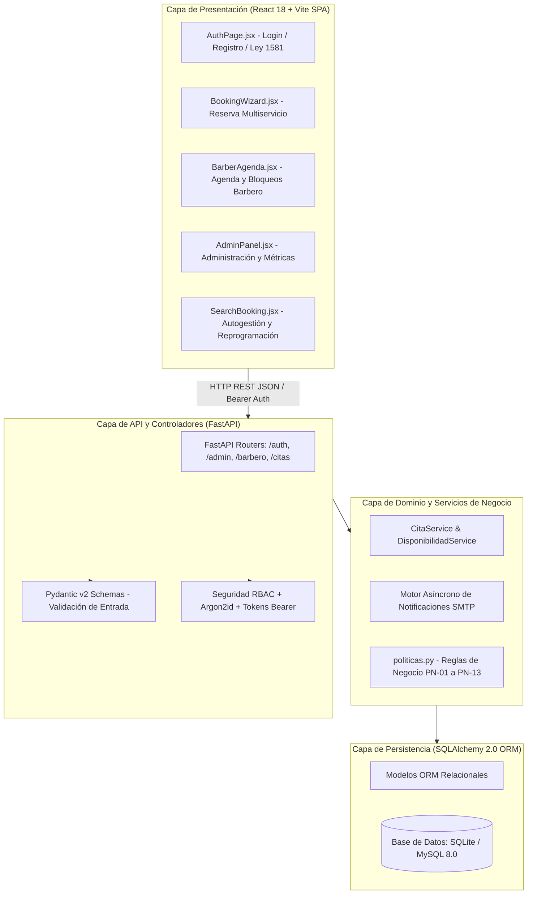
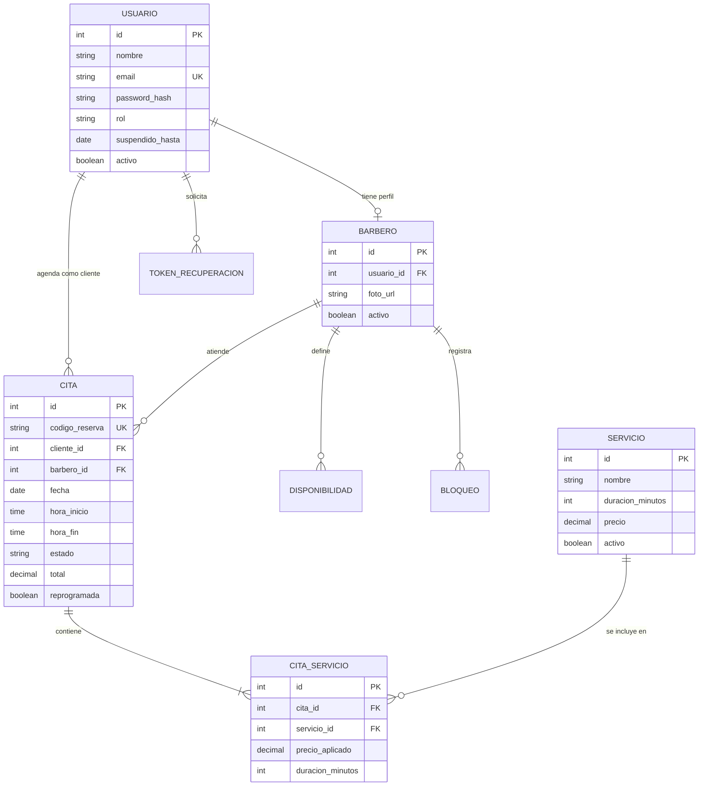

# BarberShop Pro 💈✂️
### Sistema Integral de Gestión de Barberías y Reserva de Citas

[](https://fastapi.tiangolo.com/)
[](https://www.python.org/)
[](https://www.sqlalchemy.org/)
[](https://docs.pydantic.dev/)
[](https://react.dev/)
[](#)
[-brightgreen.svg?style=flat-square)](#)
[](#)
[](#)

---

## 📌 1. Presentación Institucional y Equipo de Proyecto

**BarberShop Pro** es una plataforma de software desarrollada para la modernización, control operativo y gestión ágil de turnos para barberías profesionales. El proyecto se enmarca dentro de las buenas prácticas de ingeniería de software, arquitectura modular en capas, diseño orientado al dominio y control de calidad basado en desarrollo guiado por comportamiento (**BDD**).

- **Institución:** Corporación de Estudios Tecnológicos del Norte del Valle — Cotecnova  
- **Materia:** Ingeniería de Software II (Código 17934)  
- **Docente:** Felipe Gutiérrez Isaza  
- **Período:** 2026-2  
- **Versión del Sistema:** 1.1 (Seguimiento 2)  

### 👥 Equipo de Desarrollo y Roles

| Integrante | Rol Asignado | Responsabilidad Principal | Entregables Clave |
| :--- | :--- | :--- | :--- |
| **Elizabeth Ramirez** | *Líder Técnico & Backend Core* | Arquitectura del backend, modelos relacionales SQLAlchemy 2.0, API REST, modelado UML 2.5 y control de integración continua. | `src/backend/`, modelos ORM, `docs/diagramas-uml.md`, `compilar_diagramas.py`, favicon corporativo. |
| **Juan David Monroy** | *Documentación & Requisitos Formales* | Especificación de requisitos formales (RF/RNF), historias de usuario con criterios Gherkin y manual de gestión ágil. | `README.md`, `docs/especificacion.md`, `docs/guia-trello.md`. |
| **Sebastian Orozco** | *Responsable de Pruebas & QA* | Diseño de casos de prueba formales (Partición de Equivalencia y BVA), suite automatizada con `pytest` y pruebas de rendimiento. | `docs/plan-de-pruebas.md`, 9 suites de pruebas unitarias/integración (283 tests), pruebas frontend JS. |
| **Juan David Osorio** | *Responsable de Calidad & Mantenimiento* | Auditoría de código, aseguramiento de seguridad (Argon2id), registro formal de defectos (`DEF-001` a `DEF-006`) y categorización ISO/IEC 14764. | `docs/informe-calidad.md`, auditoría `.env.example`, gestión de mantenimiento de software. |

---

## 📌 2. Gestión Ágil en Trello

El seguimiento ágil del proyecto, la asignación de tarjetas y la trazabilidad de tareas hacia los commits del repositorio se gestionan a través de:
* **Enlace al Tablero de Trello:** [Tablero Oficial - BarberShop Pro Cotecnova 2026-2](https://trello.com/) *(Consultar [docs/guia-trello.md](docs/guia-trello.md) para la guía completa de configuración, listas obligatorias y etiquetas).*

---

## 🚀 3. Visión y Objetivos del Sistema

El objetivo de **BarberShop Pro** es solucionar de forma automatizada las ineficiencias de agendamiento en salones de barbería:

1. **Agendamiento Inteligente sin Choques (Zero Overbooking)**: Algoritmo matemático estricto que evalúa en tiempo real colisiones entre franjas horarias:
   $$\max(\text{Inicio}_A, \text{Inicio}_B) < \min(\text{Fin}_A, \text{Fin}_B)$$
   Permitiendo citas consecutivas contiguas ($\text{Fin}_A = \text{Inicio}_B$) sin falsos positivos.
2. **Citas Multiservicio**: Capacidad para agrupar múltiples servicios en un mismo turno, calculando automáticamente la duración total acumulada y el costo total con precios congelados (`CitaServicio`).
3. **Control de Acceso Basado en Roles (RBAC)**: Tres perfiles con permisos independientes: **Cliente** (autogestión), **Barbero** (agenda, disponibilidad y marcación de asistencia) y **Administrador** (gestión de personal, catálogo y supervisión global).
4. **Notificaciones Omnicanal**: Motor asíncrono en segundo plano (`BackgroundTasks`) con despacho de correos HTML para confirmación, reprogramación, cancelación y recordatorios.
5. **Políticas de Inasistencia y Penalización**: Suspensión automática de clientes por 1 mes al acumular 2 inasistencias en una ventana de 3 meses (**PN-10**).
6. **Trazabilidad Inmediata**: Códigos institucionales alfanuméricos únicos con formato `BSP-XXXXXX`.

---

## 🏛️ 4. Arquitectura del Sistema (ISO/IEC 12207)

El proyecto adopta una **arquitectura desacoplada en cuatro capas**:



### 🗄️ Diagrama Entidad-Relación (DER)



---

## 📐 5. Diagramas UML Formales (Estándar UML 2.5 / ISO 19505)

El sistema cuenta con **10 diagramas formales compilados** en código fuente Mermaid (`.mmd`), imágenes de alta resolución PNG (x2) y archivos vectoriales SVG en `docs/diagramas/`. Para una explicación exhaustiva, consultar [docs/diagramas-uml.md](docs/diagramas-uml.md):

1. **Diagrama de Casos de Uso del Sistema:** 21 casos de uso con relaciones de inclusión (`<<include>>`) y extensión.
2. **Diagrama de Clases del Dominio y Servicios:** Atributos tipados, métodos, dependencias y multiplicidades.
3. **Diagrama Entidad-Relación (DER):** Estructura del modelo de persistencia relacional en 3NF.
4. **Diagrama de Secuencia — Agendamiento Multiservicio:** Flujo de cálculo, validación y confirmación por correo.
5. **Diagrama de Secuencia — Gestión de Inasistencias:** Flujo de marcación y suspensión de cuenta (PN-10).
6. **Diagrama de Secuencia — Reprogramación de Cita:** Validación de ventana de 12 horas y límite de intento único.
7. **Diagrama de Estados:** Ciclos de vida para citas y cuentas de usuario.
8. **Diagrama de Componentes:** Desacoplamiento de componentes de interfaz, routers, esquemas, servicios y repositorio.
9. **Diagrama de Despliegue:** Nodos cliente web, servidor web frontend, servidor ASGI y motor relacional.
10. **Diagrama de Paquetes:** Modularización estricta bajo directrices ISO/IEC 12207.

---

## 📁 6. Estructura del Repositorio

```text
gestor-barberia/
├── README.md                      # Presentación, roles, arquitectura, endpoints y puesta en marcha
├── .gitignore                     # Exclusión de archivos sensibles, DBs, venv y node_modules
├── docs/                          # Documentación formal de Ingeniería de Software
│   ├── especificacion.md          # 30 Requisitos Funcionales (Gherkin), 10 RNF y 13 Políticas
│   ├── diagramas-uml.md           # Catálogo formal de 10 diagramas UML 2.5
│   ├── diagramas/                 # Fuentes Mermaid (.mmd), imágenes PNG (x2) y SVG vectoriales
│   │   └── compilar_diagramas.py  # Script automatizado de compilación de diagramas
│   ├── plan-de-pruebas.md         # Técnicas formales (Partición de Equivalencia y BVA)
│   ├── informe-calidad.md         # Auditoría v2.0, registro de defectos (DEF-001 a DEF-006) e ISO 14764
│   ├── informe-semanal-2          # Informe técnico y evolutivo detallado de la Semana 2 (Seguimiento 2)
│   └── guia-trello.md             # Manual metodológico de gestión Kanban y matriz RACI
├── src/                           # Código fuente del sistema
│   ├── backend/                   # Backend profesional en FastAPI
│   │   ├── .env.example           # Plantilla sanitizada de variables de entorno (Cero secretos en git)
│   │   ├── database.py            # Motor SQLAlchemy y generador de sesión de BD
│   │   ├── main.py                # Routers REST, middlewares de seguridad y CORS
│   │   ├── models.py              # 8 Entidades ORM (Usuario, Barbero, Servicio, Cita, etc.)
│   │   ├── notificaciones.py      # Motor SMTP asíncrono en segundo plano
│   │   ├── plantillas_correo.py   # Plantillas HTML responsivas para notificaciones
│   │   ├── politicas.py           # Reglas de negocio desacopladas (PN-01 a PN-13)
│   │   ├── requirements.txt       # Dependencias declaradas (FastAPI, Argon2id, SQLAlchemy, etc.)
│   │   ├── schemas.py             # DTOs y validadores estrictos con Pydantic v2
│   │   ├── security.py            # Hashing Argon2id y tokens de autenticación
│   │   ├── seed.py                # Semillero inicial de datos (Admin, barberos y catálogo)
│   │   └── services.py            # Lógica de dominio anti-solapamiento, slots y suspensiones
│   └── frontend/                  # Aplicación SPA en React 18 + Vite
│       ├── public/favicon.svg     # Favicon corporativo con poste de barbería
│       └── src/
│           ├── AuthContext.jsx    # Manejo global de autenticación, roles y sesión
│           ├── api.js             # Cliente API unificado con cabeceras Bearer
│           └── components/        # Vistas: AdminPanel, BarberAgenda, BookingWizard, SearchBooking
└── tests/                         # Suite de pruebas automatizadas con Pytest (283 pruebas)
    ├── conftest.py                # Fixtures de BD aislada en memoria y tokens RBAC
    ├── test_admin.py              # Pruebas del panel de administración
    ├── test_agendamiento.py       # Pruebas de agendamiento multiservicio y solapamiento
    ├── test_barbero.py            # Pruebas de agenda y bloqueos de barbero
    ├── test_citas.py              # Suite de regresión histórica adaptada a RBAC
    ├── test_cuentas.py            # Pruebas de registro, login, hashing y expiración
    ├── test_gestion_citas.py      # Pruebas de cancelación y reprogramación (12h)
    ├── test_inasistencias.py      # Pruebas de suspensión preventiva por inasistencias
    ├── test_no_funcionales.py     # Pruebas RNF (concurrencia 20 hilos, carga 500 citas, SQLi)
    └── test_notificaciones.py     # Pruebas de despacho asíncrono y sanitización SMTP
```

---

## ⚡ 7. Instalación y Puesta en Marcha

### Prerrequisitos
* **Python 3.11 o superior** instalado (`python --version`)
* **Node.js v18 o superior** instalado (`node --version`)
* **Git** instalado (`git --version`)

---

### Opción A: Inicialización Automática en Windows (Scripts .bat)

El proyecto cuenta con scripts de arranque en la raíz para facilitar la puesta en marcha:

1. **Iniciar Backend:**
   ```powershell
   .\iniciar-backend.bat
   ```
   *(Crea el entorno virtual si no existe, instala `requirements.txt`, corre el `seed.py` y levanta Uvicorn en `http://127.0.0.1:8000`).*

2. **Iniciar Frontend:**
   ```powershell
   .\iniciar-frontend.bat
   ```
   *(Instala dependencias de Node y arranca Vite en `http://localhost:5173`).*

---

### Opción B: Ejecución Manual Paso a Paso

#### 1. Backend (FastAPI)
```bash
cd src/backend

# Crear y activar entorno virtual
python -m venv venv
# En Windows (PowerShell):
.\venv\Scripts\Activate.ps1
# En Linux / macOS:
source venv/bin/activate

# Instalar dependencias
pip install -r requirements.txt

# Configurar variables de entorno (usar SQLite local para pruebas rápidas)
cp .env.example .env

# Poblar datos iniciales
python seed.py

# Iniciar servidor
uvicorn main:app --host 127.0.0.1 --port 8000 --reload
```

* **API Base:** `http://127.0.0.1:8000`
* **Swagger UI Interactiva:** `http://127.0.0.1:8000/docs`
* **ReDoc:** `http://127.0.0.1:8000/redoc`

#### 2. Frontend (React 18 + Vite)
```bash
cd src/frontend

# Instalar dependencias
npm install

# Iniciar en modo desarrollo
npm run dev
```

* **Aplicación Web:** `http://localhost:5173`

---

## 🧪 8. Ejecución de Pruebas Automatizadas

Para correr la suite de **283 pruebas unitarias, de integración y no funcionales**:

```bash
# Estando en la raíz del proyecto o en src/backend con el entorno virtual activo:
pytest tests/ -v
```

Para verificar las pruebas unitarias de frontend en JavaScript:
```bash
cd src/frontend
npm test
```

---

## 📖 9. Resumen de Endpoints de la API REST

| Módulo | Método | Endpoint | Descripción | Acceso / Rol |
| :--- | :--- | :--- | :--- | :--- |
| **Auth** | `POST` | `/api/auth/registro` | Registro de nuevos clientes (Ley 1581) | Público |
| **Auth** | `POST` | `/api/auth/login` | Autenticación y expedición de Token | Público |
| **Auth** | `GET` | `/api/auth/perfil` | Consulta del perfil del usuario autenticado | Bearer Token |
| **Auth** | `POST` | `/api/auth/recuperar` | Solicitud de token de recuperación | Público |
| **Admin** | `GET/POST` | `/api/admin/barberos` | Gestión del personal de barberos | `ADMIN` |
| **Admin** | `POST` | `/api/admin/servicios` | Alta de nuevos servicios en el catálogo | `ADMIN` |
| **Admin** | `GET` | `/api/admin/citas` | Supervisión general de citas con filtros | `ADMIN` |
| **Barbero** | `GET` | `/api/barbero/agenda` | Agenda diaria del barbero autenticado | `BARBERO` |
| **Barbero** | `POST` | `/api/barbero/disponibilidad` | Configurar horario de atención semanal | `BARBERO` |
| **Barbero** | `POST` | `/api/barbero/bloqueos` | Registrar bloqueo puntual de fechas/horas | `BARBERO` |
| **Barbero** | `PATCH` | `/api/barbero/citas/{id}/atender` | Marcar cita como `Atendida` | `BARBERO` |
| **Barbero** | `PATCH` | `/api/barbero/citas/{id}/inasistencia` | Marcar `Inasistencia` y evaluar suspensión | `BARBERO` |
| **Citas** | `GET` | `/api/servicios` | Listar catálogo de servicios disponibles | Público |
| **Citas** | `GET` | `/api/disponibilidad` | Consultar turnos libres por barbero y fecha | Público |
| **Citas** | `POST` | `/api/citas` | Agendar cita multiservicio (`BSP-XXXXXX`) | `CLIENTE` |
| **Citas** | `GET` | `/api/citas/mis-citas` | Listado de citas del cliente autenticado | `CLIENTE` |
| **Citas** | `GET` | `/api/citas/codigo/{codigo}` | Buscar detalles por código institucional | Público |
| **Citas** | `PATCH` | `/api/citas/{id}/cancelar` | Cancelar cita con anticipación $\ge 12$ h | `CLIENTE` |
| **Citas** | `PATCH` | `/api/citas/{id}/reprogramar` | Reprogramar turno (máx 1 vez, $\ge 12$ h) | `CLIENTE` |

---

## 🔒 10. Políticas de Calidad y Seguridad Institucional

1. **Cero Secretos en el Repositorio (RNF-10):** El archivo `.gitignore` prohíbe explícitamente subir archivos `.env`, contraseñas o archivos de base de datos (`*.sqlite`, `*.db`). La plantilla `.env.example` se encuentra 100% sanitizada sin hosts ni credenciales privadas.
2. **Cifrado Criptográfico de Contraseñas (RNF-01):** Implementación de **Argon2id**, el estándar más avanzado de hashing resistente a ataques por GPU/ASIC.
3. **Control de Entradas Estricto (RNF-09):** Validación con Pydantic v2 contra valores negativos en tarifas, duraciones fuera de rango (1 a 240 min) y cadenas compuestas solo por espacios.
4. **Manejo Semántico de Códigos HTTP:** La API no expone errores genéricos `500`; utiliza códigos semánticos (`400 Bad Request`, `401 Unauthorized`, `403 Forbidden`, `404 Not Found`, `409 Conflict`, `422 Unprocessable Entity`).
5. **Integridad Referencial con Claves Foráneas (RNF-07):** Uso de `ondelete="RESTRICT"` para evitar eliminación accidental en cascada de entidades relacionadas.

---

## 🏷️ Historial de Entregas y Tags

* **Seguimiento 1:** `git tag entrega-s1`
* **Seguimiento 2:** `git tag entrega-s2`
* **Entrega Final:** `git tag entrega-final`

---

## 📄 Licencia

Proyecto de desarrollo de software académico — Corporación de Estudios Tecnológicos del Norte del Valle (**Cotecnova**), 2026. Todos los derechos reservados.
