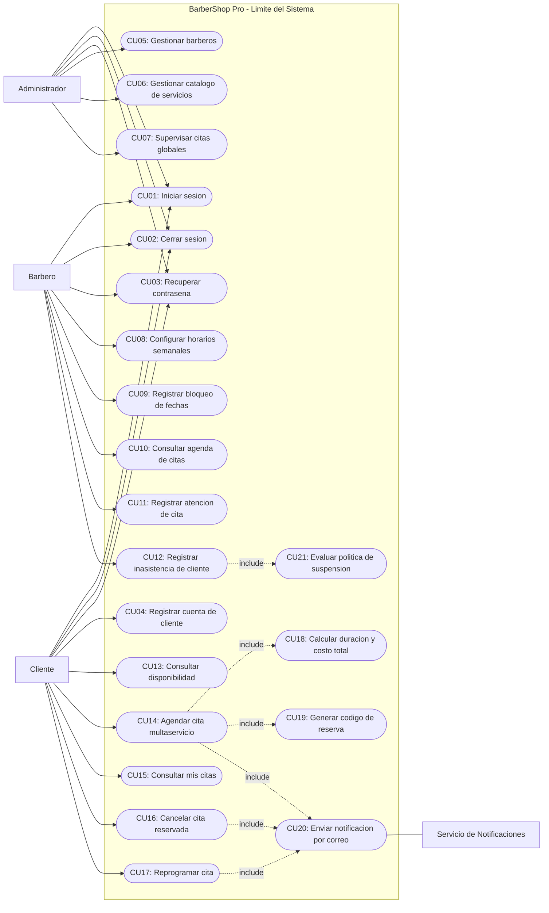
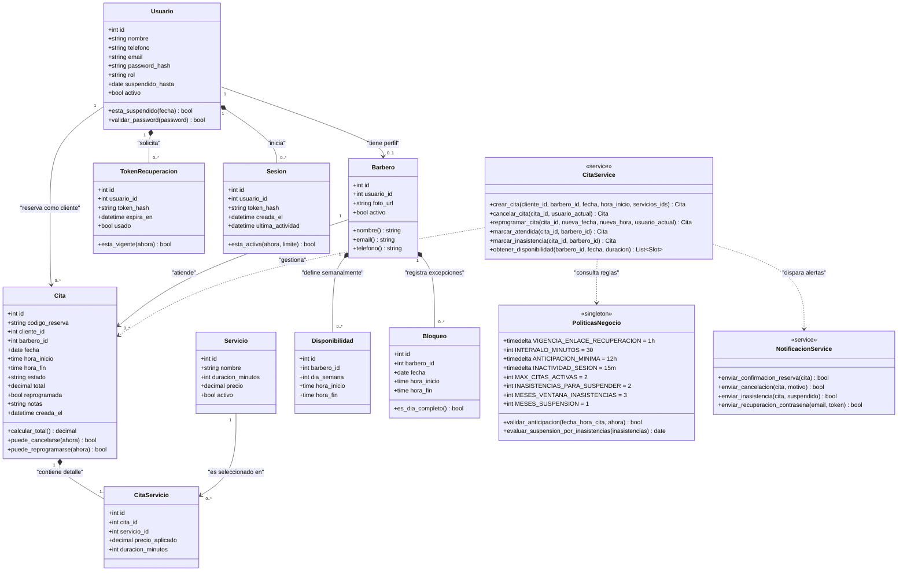
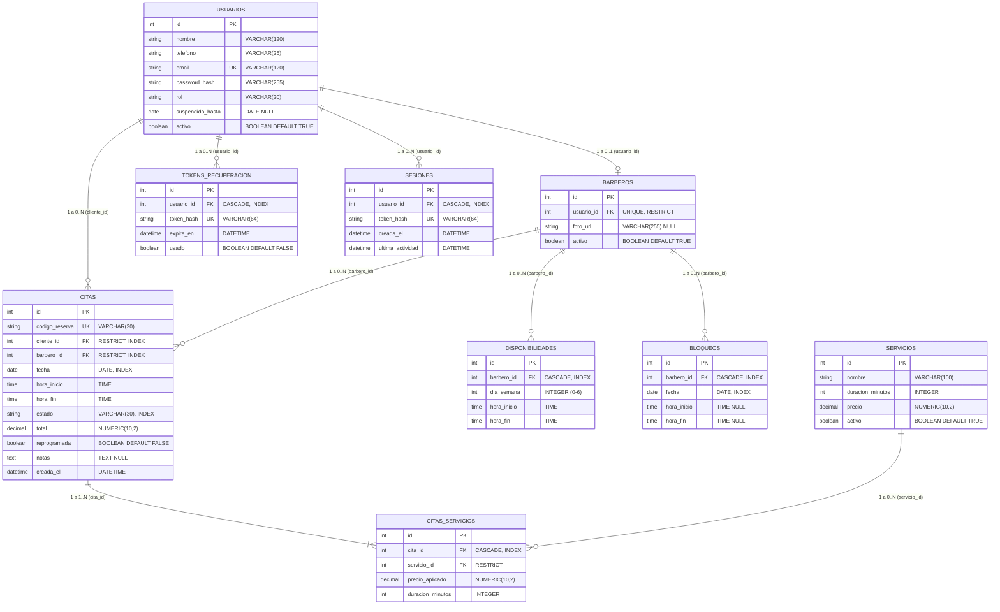
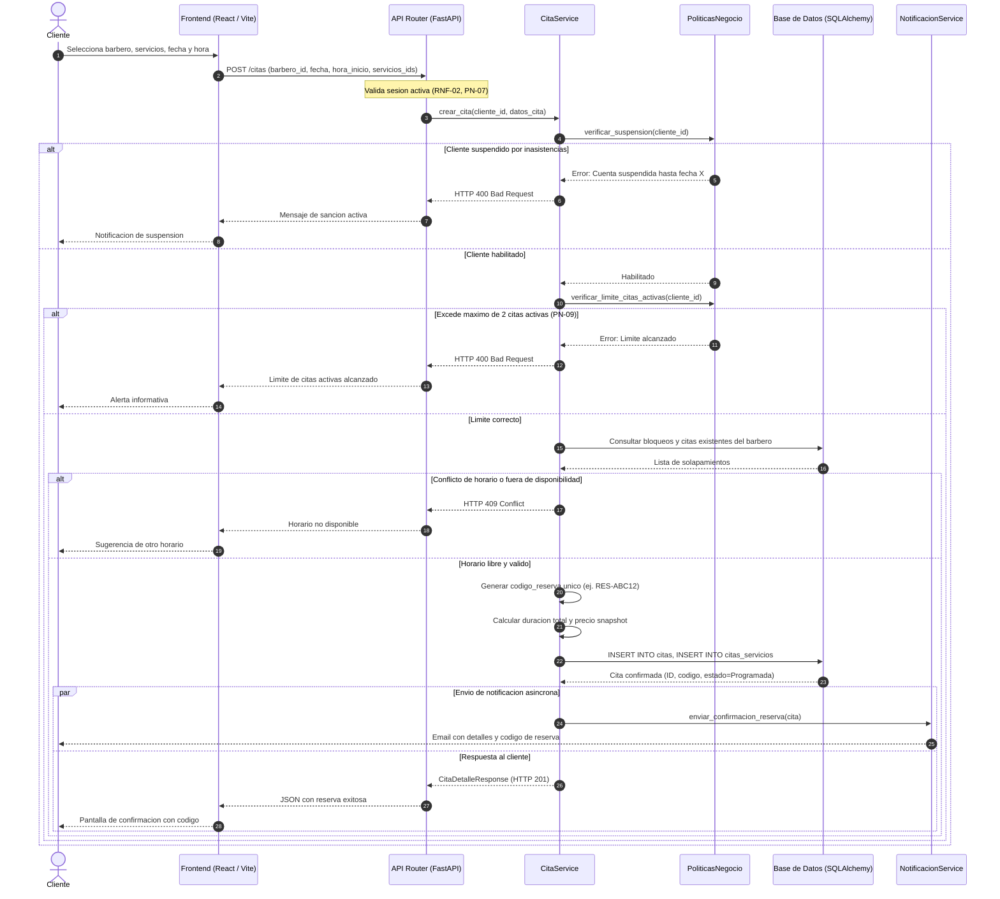
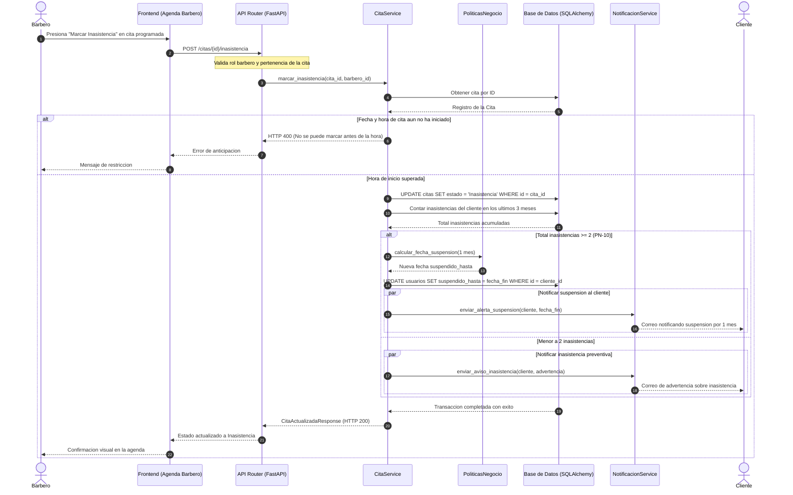
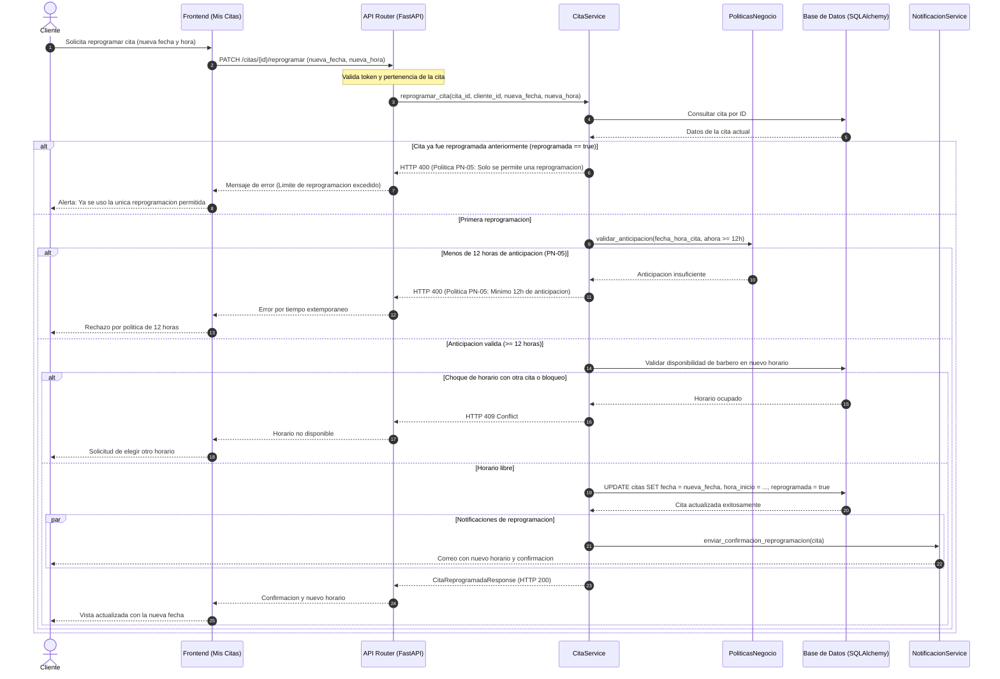
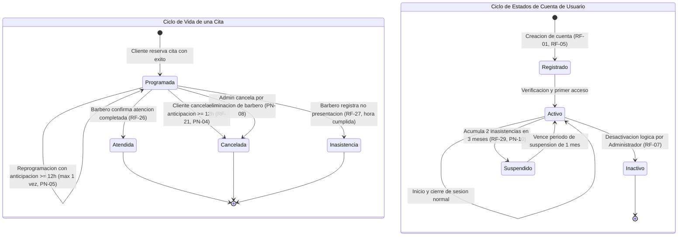
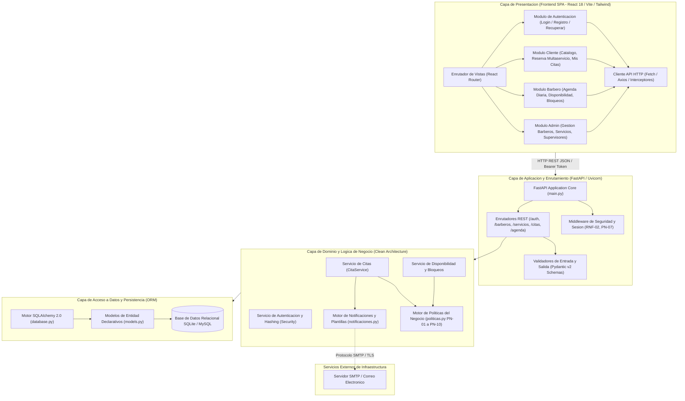
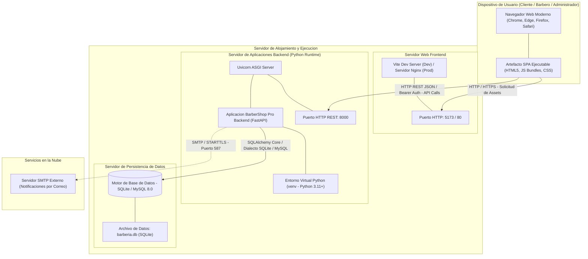
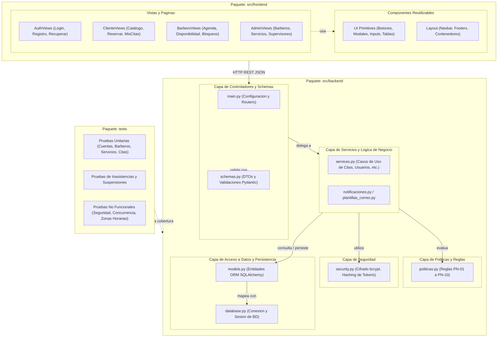

# Documentacion de Diagramas UML del Sistema — BarberShop Pro

Este documento compila y formaliza la arquitectura, diseno estructural y modelado de comportamiento del sistema **BarberShop Pro** (version 1.1) bajo el estandar formal **UML 2.5 (ISO/IEC 19505)**.

Cada diagrama cuenta con su codigo fuente en formato Mermaid y sus versiones compiladas en alta resolucion tanto en formato de imagen de mapa de bits (PNG escala x2 con fondo blanco solido) como vectorial escalable (SVG), ubicadas en el directorio `docs/diagramas/` y respaldadas en el Escritorio del usuario (`Desktop/Diagramas_UML_BarberShop`).

---

## Indice de Diagramas UML

1. [Diagrama de Casos de Uso del Sistema](#1-diagrama-de-casos-de-uso-del-sistema)
2. [Diagrama de Clases del Dominio y Servicios](#2-diagrama-de-clases-del-dominio-y-servicios)
3. [Diagrama Entidad-Relacion (Modelo Relacional)](#3-diagrama-entidad-relacion-modelo-relacional)
4. [Diagrama de Secuencia: Agendamiento de Cita Multaservicio](#4-diagrama-de-secuencia-agendamiento-de-cita-multaservicio)
5. [Diagrama de Secuencia: Gestion de Inasistencia y Suspension](#5-diagrama-de-secuencia-gestion-de-inasistencia-y-suspension)
6. [Diagrama de Secuencia: Reprogramacion de Cita con Politicas](#6-diagrama-de-secuencia-reprogramacion-de-cita-con-politicas)
7. [Diagrama de Estados: Ciclo de Vida de Cita y Cuenta de Usuario](#7-diagrama-de-estados-ciclo-de-vida-de-cita-y-cuenta-de-usuario)
8. [Diagrama de Componentes (Arquitectura en Capas)](#8-diagrama-de-componentes-arquitectura-en-capas)
9. [Diagrama de Despliegue (Infraestructura de Ejecucion)](#9-diagrama-de-despliegue-infraestructura-de-ejecucion)
10. [Diagrama de Paquetes (Organizacion Modular)](#10-diagrama-de-paquetes-organizacion-modular)

---

## 1. Diagrama de Casos de Uso del Sistema

### Proposito
Modela las interacciones funcionales entre los actores externos (`Cliente`, `Barbero`, `Administrador` y `Servicio de Notificaciones`) y los modulos delimitados dentro del sistema BarberShop Pro, evidenciando las relaciones de inclusion (`<<include>>`) para calculos, codigos de reserva y politicas de suspension.

### Archivos Generados
- Codigo fuente: `docs/diagramas/01-casos-de-uso.mmd`
- Imagen de alta resolucion: `docs/diagramas/01-casos-de-uso.png`
- Vectorial: `docs/diagramas/01-casos-de-uso.svg`

---

## 2. Diagrama de Clases del Dominio y Servicios

### Proposito
Representa la estructura estatica orientada a objetos de la aplicacion, detallando atributos tipados, metodos de instancia, operaciones de servicios de aplicacion, constantes de politicas y multiplicidades exactas de las asociaciones y composiciones.

### Archivos Generados
- Codigo fuente: `docs/diagramas/02-diagrama-clases.mmd`
- Imagen de alta resolucion: `docs/diagramas/02-diagrama-clases.png`
- Vectorial: `docs/diagramas/02-diagrama-clases.svg`

---

## 3. Diagrama Entidad-Relacion (Modelo Relacional)

### Proposito
Describe el esquema fisico y logico de la base de datos relacional (compatible con SQLite y MySQL 8.0), identificando claves primarias (PK), foraneas (FK), restricciones de integridad referencial (`RESTRICT`, `CASCADE`), indices de rendimiento y tipos SQL.

### Archivos Generados
- Codigo fuente: `docs/diagramas/03-diagrama-erd.mmd`
- Imagen de alta resolucion: `docs/diagramas/03-diagrama-erd.png`
- Vectorial: `docs/diagramas/03-diagrama-erd.svg`

---

## 4. Diagrama de Secuencia: Agendamiento de Cita Multaservicio

### Proposito
Ilustra el intercambio dinamico de mensajes para el caso de uso `CU14: Agendar cita multaservicio` (RF-13 a RF-20), cubriendo las validaciones de suspension del cliente, limite de citas activas (PN-09), comprobacion de choques de horario, persistencia atomica con snapshot de precios y despacho de confirmacion por correo.

### Archivos Generados
- Codigo fuente: `docs/diagramas/04-secuencia-agendamiento.mmd`
- Imagen de alta resolucion: `docs/diagramas/04-secuencia-agendamiento.png`
- Vectorial: `docs/diagramas/04-secuencia-agendamiento.svg`

---

## 5. Diagrama de Secuencia: Gestion de Inasistencia y Suspension

### Proposito
Detalla el flujo de ejecucion cuando un barbero reporta que un cliente no comparecio a su cita (RF-27 y RF-29), aplicando la regla de negocio PN-10 (suspension automatica de 1 mes al registrar 2 inasistencias en una ventana de 3 meses).

### Archivos Generados
- Codigo fuente: `docs/diagramas/05-secuencia-inasistencia.mmd`
- Imagen de alta resolucion: `docs/diagramas/05-secuencia-inasistencia.png`
- Vectorial: `docs/diagramas/05-secuencia-inasistencia.svg`

---

## 6. Diagrama de Secuencia: Reprogramacion de Cita con Politicas

### Proposito
Modela el proceso de reprogramacion de una cita (RF-23), haciendo cumplir la politica de una unica reprogramacion permitida (`reprogramada == false`) y el umbral de anticipacion minima de 12 horas (PN-04 y PN-05).

### Archivos Generados
- Codigo fuente: `docs/diagramas/06-secuencia-reprogramacion.mmd`
- Imagen de alta resolucion: `docs/diagramas/06-secuencia-reprogramacion.png`
- Vectorial: `docs/diagramas/06-secuencia-reprogramacion.svg`

---

## 7. Diagrama de Estados: Ciclo de Vida de Cita y Cuenta de Usuario

### Proposito
Modela las maquinas de estados finitos que gobiernan los ciclos de vida de:
1. Una `Cita` (transiciones entre `Programada`, `Atendida`, `Cancelada` e `Inasistencia`).
2. Una `Cuenta de Usuario` (transiciones entre `Registrado`, `Activo`, `Suspendido` e `Inactivo`).

### Archivos Generados
- Codigo fuente: `docs/diagramas/07-estados-cita-usuario.mmd`
- Imagen de alta resolucion: `docs/diagramas/07-estados-cita-usuario.png`
- Vectorial: `docs/diagramas/07-estados-cita-usuario.svg`

---

## 8. Diagrama de Componentes (Arquitectura en Capas)

### Proposito
Muestra la arquitectura en capas desacopladas (Clean Layer Separation) del sistema: Capa de Presentacion (Frontend SPA), Capa de Enrutamiento y Validacion (FastAPI), Capa de Dominio y Politicas (`services.py`, `politicas.py`), Capa de Persistencia (SQLAlchemy 2.0 ORM) y Servicios Externos de Notificacion (SMTP).

### Archivos Generados
- Codigo fuente: `docs/diagramas/08-diagrama-componentes.mmd`
- Imagen de alta resolucion: `docs/diagramas/08-diagrama-componentes.png`
- Vectorial: `docs/diagramas/08-diagrama-componentes.svg`

---

## 9. Diagrama de Despliegue (Infraestructura de Ejecucion)

### Proposito
Especifica la topologia fisica y logica de despliegue: nodos de cliente (navegador web), servidores web frontend, servidores de aplicacion backend (Uvicorn ASGI) y almacenamiento de persistencia (SQLite/MySQL).

### Archivos Generados
- Codigo fuente: `docs/diagramas/09-diagrama-despliegue.mmd`
- Imagen de alta resolucion: `docs/diagramas/09-diagrama-despliegue.png`
- Vectorial: `docs/diagramas/09-diagrama-despliegue.svg`

---

## 10. Diagrama de Paquetes (Organizacion Modular)

### Proposito
Ilustra la modularizacion del proyecto bajo las directrices de ISO/IEC 12207, organizando los paquetes de Frontend, Backend y Tests, y declarando explicitamente las dependencias unidireccionales para evitar acoplamiento circular.

### Archivos Generados
- Codigo fuente: `docs/diagramas/10-diagrama-paquetes.mmd`
- Imagen de alta resolucion: `docs/diagramas/10-diagrama-paquetes.png`
- Vectorial: `docs/diagramas/10-diagrama-paquetes.svg`

