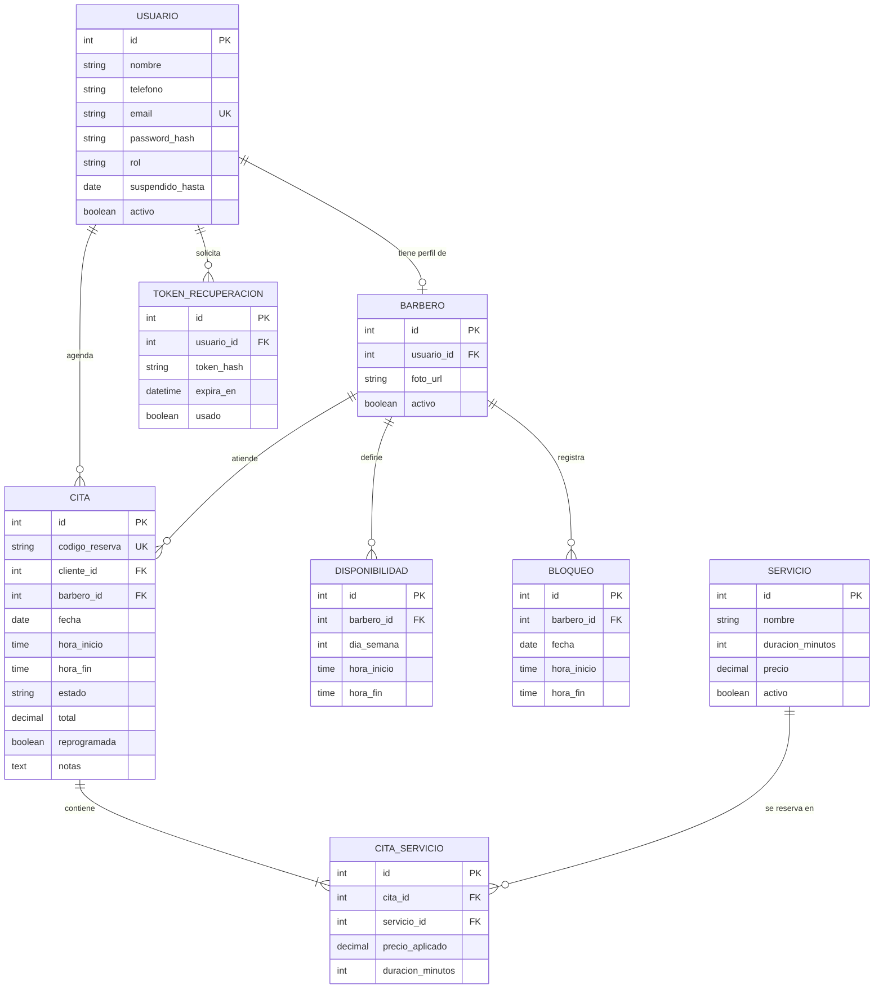

# 📄 Especificación de Requisitos y Criterios de Aceptación
 
**Proyecto:** BarberShop Pro — Sistema de Gestión y Agendamiento de Barbería
**Curso:** Ingeniería de Software II (Código 17934) — Cotecnova
**Versión:** 1.1 (propuesta de modificación sobre la v1.0 del Seguimiento 1)
**Responsable de Documentación:** Juan David Monroy
**Revisado por:** Elizabeth Ramirez (Líder Técnico), Juan David Osorio (Calidad)
 
---
 
## 1. Introducción y Propósito
 
El presente documento formaliza los requisitos funcionales, no funcionales y criterios de aceptación para el desarrollo del sistema **BarberShop Pro**. La aplicación tiene como objetivo resolver los problemas operativos comunes en barberías urbanas: pérdidas de turnos por desorganización, doble reserva simultánea de barberos y falta de visibilidad del rendimiento del personal.
 
Esta versión incorpora cuentas con inicio de sesión por rol, disponibilidad definida por cada barbero, citas con varios servicios y una sección de políticas del negocio que concentra los valores configurables (tiempos, límites y sanciones).
 
---
 
## 2. Actores del Sistema y Términos
 
| Actor | Descripción |
|---|---|
| **Cliente** | Usuario final con cuenta propia. Consulta servicios y disponibilidad, agenda, cancela y reprograma sus citas. |
| **Barbero** | Profesional con cuenta creada por el administrador. Define su disponibilidad, visualiza su agenda y actualiza el estado de atención de las citas. |
| **Administrador** | Administra el catálogo de servicios, gestiona barberos, consulta todas las citas y supervisa el flujo general de la barbería. |
 
| Término | Definición |
|---|---|
| **Estados de una cita** | `Programada`, `Atendida`, `Cancelada` e `Inasistencia`. |
| **Cita activa** | Cita en estado `Programada`. |
| **Inasistencia** | El cliente no se presenta a la cita sin haberla cancelado con la anticipación de la política PN-04. Es el estado que marca el barbero en RF-27. |
 
---
 
## 3. Modelo de Entidades Principales
 

 
**Notas del modelo:**
 
- `CITA_SERVICIO` guarda el precio y la duración vigentes al momento de reservar, para que modificar un servicio (RF-09) no altere citas ya agendadas.
- Eliminar un barbero o un servicio (RF-07, RF-10) es una eliminación lógica (`activo = false`), para conservar el historial.
- `USUARIO.suspendido_hasta` guarda la fecha en que termina la suspensión por inasistencias (RF-29).
---
 
## 4. Requisitos Funcionales (RF)
 
> Los valores entre paréntesis en los criterios de aceptación provienen de la sección 6 (Políticas del negocio). Si una política cambia, se actualizan los criterios que la citan.
 
### 4.1 Cuentas y acceso
 
### 📌 RF-01: Registro de Clientes
* **Descripción:** El sistema debe permitir al cliente registrarse con nombre, teléfono, correo electrónico y contraseña.
* **Criterios de Aceptación:**
  * **CA-01.1:** *Dado* un cliente con datos válidos y un correo que no está en el sistema, *cuando* se registra, *entonces* el sistema crea la cuenta y el cliente puede iniciar sesión con esos datos.
  * **CA-01.2:** *Dado* un correo ya registrado, *cuando* se envía el registro, *entonces* el sistema rechaza la creación retornando `HTTP 400 Bad Request` y un aviso de que el correo ya está registrado.
### 📌 RF-02: Inicio de Sesión por Rol
* **Descripción:** El sistema debe permitir al cliente, al barbero y al administrador iniciar sesión con su correo y contraseña, y mostrar la interfaz correspondiente a su rol.
* **Criterios de Aceptación:**
  * **CA-02.1:** *Dado* un usuario con el correo que registró y su contraseña correcta, *cuando* inicia sesión, *entonces* el sistema lo deja ingresar y le muestra la interfaz de su rol.
  * **CA-02.2:** *Dado* un correo no registrado, *cuando* intenta iniciar sesión, *entonces* el sistema responde `HTTP 401 Unauthorized` y muestra un aviso indicando que el correo debe estar registrado.
### 📌 RF-03: Cierre de Sesión
* **Descripción:** El sistema debe permitir al cliente, al barbero y al administrador cerrar sesión.
* **Criterios de Aceptación:**
  * **CA-03.1:** *Dado* un usuario con sesión iniciada, *cuando* presiona "Cerrar sesión", *entonces* la sesión termina y el sistema lo lleva a la pantalla de inicio de sesión.
  * **CA-03.2:** *Dado* una sesión ya cerrada, *cuando* se intenta volver a una pantalla o recurso privado, *entonces* el sistema responde `HTTP 401` y pide iniciar sesión.
### 📌 RF-04: Recuperación de Contraseña
* **Descripción:** El sistema debe permitir al cliente, al barbero y al administrador recuperar su contraseña mediante un enlace enviado por correo, con la vigencia de la política PN-01.
* **Criterios de Aceptación:**
  * **CA-04.1:** *Dado* un usuario registrado que solicita la recuperación, *cuando* abre el enlace recibido dentro de la vigencia (1 hora), *entonces* puede definir una nueva contraseña e iniciar sesión con ella.
  * **CA-04.2:** *Dado* un enlace con más de 1 hora de emitido, *cuando* el usuario lo abre, *entonces* el sistema informa que el enlace caducó y no permite cambiar la contraseña.
### 4.2 Gestión de barberos (administrador)
 
### 📌 RF-05: Registro de Barberos
* **Descripción:** El sistema debe permitir al administrador registrar barberos con correo electrónico, contraseña, nombre y foto opcional.
* **Criterios de Aceptación:**
  * **CA-05.1:** *Dado* un barbero con datos válidos (nombre, correo único, contraseña), *cuando* el administrador lo registra, *entonces* queda almacenado con estado `activo = true`, aparece en la lista de barberos y puede iniciar sesión.
  * **CA-05.2:** *Dado* un intento de registro con un correo ya existente, *cuando* se envía la petición, *entonces* el sistema rechaza la creación retornando `HTTP 400 Bad Request` y un mensaje de error explicativo.
  * **CA-05.3:** *Dado* un registro sin nombre, *cuando* se envía la petición, *entonces* el sistema responde `HTTP 422 Unprocessable Entity` indicando que el nombre es obligatorio.
### 📌 RF-06: Modificación del Perfil del Barbero
* **Descripción:** El sistema debe permitir al administrador modificar el perfil de un barbero.
* **Criterios de Aceptación:**
  * **CA-06.1:** *Dado* un barbero registrado, *cuando* el administrador cambia su nombre y su foto y guarda, *entonces* el sistema guarda los cambios y el cliente ve el perfil actualizado al elegir barbero.
  * **CA-06.2:** *Dado* un barbero registrado, *cuando* el administrador borra el nombre y guarda, *entonces* el sistema responde `HTTP 422` y el perfil conserva los datos anteriores.
### 📌 RF-07: Eliminación del Perfil del Barbero
* **Descripción:** El sistema debe permitir al administrador eliminar el perfil de un barbero. El sistema conservará el historial de sus citas y tratará las citas futuras según la política PN-08.
* **Criterios de Aceptación:**
  * **CA-07.1:** *Dado* un barbero con citas futuras y pasadas, *cuando* el administrador elimina su perfil, *entonces* el perfil queda inactivo, las citas futuras pasan a `Cancelada`, los clientes afectados son notificados y el historial de citas se conserva.
  * **CA-07.2:** *Dado* un barbero cuyo perfil fue eliminado, *cuando* intenta iniciar sesión, *entonces* el sistema no lo deja ingresar.
### 4.3 Catálogo y gestión de servicios (administrador)
 
### 📌 RF-08: Registro de Servicios
* **Descripción:** El sistema debe permitir al administrador agregar servicios indicando nombre, precio y duración en minutos.
* **Criterios de Aceptación:**
  * **CA-08.1:** *Dado* un nuevo servicio con duración > 0 minutos y precio ≥ 0, *cuando* se guarda, *entonces* queda disponible en el catálogo de citas.
  * **CA-08.2:** *Dado* un servicio con duración menor o igual a cero (ej. 0 o -15 min), *cuando* se envía la solicitud, *entonces* el sistema debe responder con un error de validación `HTTP 422 Unprocessable Entity`.
  * **CA-08.3:** *Dado* un servicio con precio vacío o negativo, *cuando* se intenta registrar, *entonces* el sistema debe rechazarlo impidiendo su persistencia.
### 📌 RF-09: Modificación de Servicios
* **Descripción:** El sistema debe permitir al administrador modificar un servicio. Las citas ya agendadas conservarán el precio con el que se reservaron.
* **Criterios de Aceptación:**
  * **CA-09.1:** *Dado* un servicio con citas ya agendadas, *cuando* el administrador cambia su precio, *entonces* las citas nuevas usan el precio nuevo y las ya agendadas conservan el anterior.
  * **CA-09.2:** *Dado* un servicio existente, *cuando* el administrador deja el nombre vacío y guarda, *entonces* el sistema responde `HTTP 422` y el servicio conserva sus datos anteriores.
### 📌 RF-10: Eliminación de Servicios
* **Descripción:** El sistema debe permitir al administrador eliminar un servicio sin afectar las citas pasadas ni las ya agendadas.
* **Criterios de Aceptación:**
  * **CA-10.1:** *Dado* un servicio con citas pasadas y citas ya agendadas, *cuando* el administrador lo elimina, *entonces* el servicio queda inactivo y las citas existentes no cambian.
  * **CA-10.2:** *Dado* un servicio eliminado, *cuando* un cliente intenta agendar una cita, *entonces* el servicio no aparece en la lista y el sistema rechaza cualquier intento de elegirlo.
### 4.4 Disponibilidad (barbero)
 
### 📌 RF-11: Definición de Horarios Disponibles
* **Descripción:** El sistema debe permitir al barbero definir sus horarios disponibles por día de la semana, según el intervalo de la política PN-02.
* **Criterios de Aceptación:**
  * **CA-11.1:** *Dado* un barbero autenticado, *cuando* define los lunes disponible de `08:00` a `12:00` en intervalos de 30 minutos, *entonces* el sistema guarda el horario y los clientes ven esos espacios disponibles los lunes.
  * **CA-11.2:** *Dado* un horario con hora de fin anterior o igual a la hora de inicio, *cuando* se envía, *entonces* el sistema responde `HTTP 422` y no lo guarda.
  * **CA-11.3:** *Dado* un horario cuya hora de inicio no coincide con el intervalo de 30 minutos (ej. `08:10`), *cuando* se envía, *entonces* el sistema lo rechaza.
### 📌 RF-12: Bloqueo de Días u Horas
* **Descripción:** El sistema debe permitir al barbero bloquear días u horas específicas en las que no podrá atender.
* **Criterios de Aceptación:**
  * **CA-12.1:** *Dado* un barbero autenticado, *cuando* bloquea un día futuro, *entonces* el sistema guarda el bloqueo y ese día no ofrece horarios a los clientes.
  * **CA-12.2:** *Dado* un intento de bloquear una fecha que ya pasó, *cuando* se envía, *entonces* el sistema lo rechaza indicando que la fecha no es válida.
### 4.5 Agendamiento de citas (cliente)
 
### 📌 RF-13: Elección del Barbero
* **Descripción:** El sistema debe mostrar al cliente los barberos registrados (nombre y foto) y permitirle elegir el de su preferencia.
* **Criterios de Aceptación:**
  * **CA-13.1:** *Dado* un cliente que entra a agendar, *cuando* abre la lista de barberos, *entonces* ve los barberos activos con nombre y foto y puede elegir uno.
  * **CA-13.2:** *Dado* un barbero eliminado por el administrador, *cuando* el cliente abre la lista, *entonces* ese barbero no aparece.
### 📌 RF-14: Elección de Servicios
* **Descripción:** El sistema debe permitir al cliente elegir uno o varios de los servicios disponibles.
* **Criterios de Aceptación:**
  * **CA-14.1:** *Dado* un cliente en la lista de servicios, *cuando* elige dos servicios, *entonces* el sistema marca ambos y le permite continuar.
  * **CA-14.2:** *Dado* un cliente que no eligió ningún servicio, *cuando* intenta continuar, *entonces* el sistema indica que debe elegir al menos uno y no avanza.
### 📌 RF-15: Cálculo del Total y la Duración
* **Descripción:** El sistema debe calcular y mostrar al cliente el total a pagar y la duración total de los servicios elegidos.
* **Criterios de Aceptación:**
  * **CA-15.1:** *Dado* un servicio de $20.000 y 30 minutos y otro de $10.000 y 15 minutos, *cuando* el cliente los elige, *entonces* el sistema muestra un total de $30.000 y una duración total de 45 minutos.
  * **CA-15.2:** *Dado* un cliente que quita todos los servicios elegidos, *cuando* se recalcula el resumen, *entonces* el total es $0 y el sistema no permite continuar.
### 📌 RF-16: Elección de la Fecha
* **Descripción:** El sistema debe permitir al cliente elegir la fecha de la cita.
* **Criterios de Aceptación:**
  * **CA-16.1:** *Dado* un cliente que elige una fecha futura, *cuando* la confirma, *entonces* el sistema la acepta y le muestra las franjas del día.
  * **CA-16.2:** *Dado* un intento de agendamiento en el pasado (fecha menor a la actual), *cuando* se valida la petición, *entonces* el sistema debe rechazarla con error `HTTP 400`.
### 📌 RF-17: Elección de la Franja del Día
* **Descripción:** El sistema debe permitir al cliente elegir una franja del día (Mañana, Tarde o Noche) mediante un selector. Las horas de cada franja se definen en la política PN-03.
* **Criterios de Aceptación:**
  * **CA-17.1:** *Dado* un cliente que elige la franja "Tarde", *cuando* la selecciona, *entonces* el sistema toma el rango de `12:00` a `18:00` y muestra los horarios de ese rango.
  * **CA-17.2:** *Dado* un cliente que no eligió franja, *cuando* intenta continuar, *entonces* el sistema indica que debe elegir una y no avanza.
### 📌 RF-18: Consulta de Horarios Libres
* **Descripción:** El sistema debe mostrar únicamente los horarios libres del barbero elegido, en la fecha y franja seleccionadas, que alcancen para la duración total de la cita.
* **Criterios de Aceptación:**
  * **CA-18.1:** *Dado* un barbero con horarios libres de `14:00` a `17:00`, la franja "Tarde" y servicios de 45 minutos, *cuando* el cliente consulta, *entonces* el sistema muestra solo los horarios libres de esa franja que alcanzan para 45 minutos.
  * **CA-18.2:** *Dado* un horario ya reservado y un último espacio que no alcanza para 45 minutos, *cuando* el cliente consulta, *entonces* el sistema no los muestra.
  * **CA-18.3:** *Dado* un día u hora bloqueados por el barbero (RF-12), *cuando* el cliente consulta, *entonces* el sistema no los muestra.
### 📌 RF-19: Confirmación y Agendamiento
* **Descripción:** El sistema debe permitir al cliente confirmar y agendar su cita, siempre que no supere el límite de citas activas de la política PN-09. El sistema calcula automáticamente la `hora_fin` sumando la duración total de los servicios a la `hora_inicio`.
* **Criterios de Aceptación:**
  * **CA-19.1:** *Dado* un cliente con 1 cita activa que elige un horario libre, *cuando* confirma, *entonces* el sistema crea la cita en estado `Programada` y genera un código de reserva único alfanumérico (ej: `BSP-A1B2C3`).
  * **CA-19.2:** *Dado* un cliente con 2 citas activas (límite), *cuando* intenta agendar una tercera, *entonces* el sistema rechaza la cita con `HTTP 409 Conflict` e indica que alcanzó el límite de citas.
  * **CA-19.3:** *Dado* servicios con duración total de 45 minutos y una hora de inicio `10:00`, *cuando* se procesa la cita, *entonces* el sistema calcula la hora de fin exactamente a las `10:45`.
### 📌 RF-20: Prevención Estricta de Choques de Horario (No Solapamiento)
* **Prioridad:** Crítica
* **Descripción:** El sistema debe impedir que un horario ya reservado sea tomado por otro cliente. Un barbero no puede tener dos citas que se superpongan en horario el mismo día.
* **Criterios de Aceptación:**
  * **CA-20.1:** *Dado* un cliente que reservó un horario libre, *cuando* otro cliente consulta los horarios del mismo barbero y fecha, *entonces* el horario reservado ya no aparece disponible.
  * **CA-20.2 (Reserva simultánea):** *Dado* que dos clientes tienen el mismo horario en pantalla, *cuando* el primero confirma y luego el segundo intenta confirmar, *entonces* el sistema acepta la primera y rechaza la segunda con `HTTP 409 Conflict`, indicando que el horario ya no está disponible.
  * **CA-20.3 (Solapamiento total o parcial):** *Dado* que el Barbero 1 ya tiene una cita de `10:00` a `10:30`, *cuando* otro cliente intenta reservar con el mismo barbero de `10:15` a `10:45`, *entonces* el sistema debe rechazar la reserva respondiendo `HTTP 409 Conflict`.
  * **CA-20.4 (Citas contiguas permitidas):** *Dado* que el Barbero 1 tiene una cita de `10:00` a `10:30`, *cuando* un cliente reserva exactamente de `10:30` a `11:00`, *entonces* el sistema debe permitir la reserva satisfactoriamente.
  * **CA-20.5 (Barberos diferentes):** *Dado* que el Barbero 1 está ocupado de `10:00` a `10:30`, *cuando* un cliente agenda a las `10:00` con el Barbero 2, *entonces* la reserva es aprobada.
### 📌 RF-21: Confirmación de la Cita por Correo
* **Descripción:** El sistema debe enviar al cliente la confirmación de su cita por correo electrónico.
* **Criterios de Aceptación:**
  * **CA-21.1:** *Dado* un cliente que agenda una cita correctamente, *cuando* el sistema la crea, *entonces* el cliente recibe un correo con barbero, servicios, fecha, hora, total y código de reserva.
  * **CA-21.2:** *Dado* una cita rechazada (por ejemplo, por límite de citas), *cuando* el sistema responde el rechazo, *entonces* no se envía ningún correo de confirmación.
### 4.6 Gestión de citas (cliente)
 
### 📌 RF-22: Consulta de Citas del Cliente
* **Descripción:** El sistema debe permitir al cliente ver sus citas agendadas y su historial.
* **Criterios de Aceptación:**
  * **CA-22.1:** *Dado* un cliente con citas agendadas y pasadas, *cuando* abre "Mis citas", *entonces* el sistema muestra sus citas agendadas y su historial.
  * **CA-22.2:** *Dado* un cliente autenticado, *cuando* consulta sus citas o intenta abrir la cita de otro cliente, *entonces* el sistema solo muestra las suyas y responde `HTTP 403 Forbidden` ante el intento ajeno.
### 📌 RF-23: Cancelación de Cita con Regla de Anticipación
* **Descripción:** El sistema debe permitir al cliente cancelar una cita con la anticipación mínima de la política PN-04.
* **Criterios de Aceptación:**
  * **CA-23.1:** *Dado* que faltan más de 12 horas para la cita, *cuando* el cliente solicita la cancelación, *entonces* el estado cambia a `Cancelada` y el horario del barbero se libera.
  * **CA-23.2:** *Dado* que faltan menos de 12 horas para la cita, *cuando* el cliente intenta cancelar, *entonces* el sistema deniega la acción informando que el límite de cancelación expiró.
### 📌 RF-24: Reprogramación de Cita
* **Descripción:** El sistema debe permitir al cliente reprogramar una cita eligiendo un nuevo horario disponible del mismo barbero, respetando las condiciones de la política PN-05.
* **Criterios de Aceptación:**
  * **CA-24.1:** *Dado* una cita que no ha sido reprogramada y que empieza en más de 12 horas, *cuando* el cliente elige un nuevo horario libre del mismo barbero, *entonces* la cita pasa al nuevo horario y el horario anterior queda libre.
  * **CA-24.2:** *Dado* una cita que ya fue reprogramada una vez, *cuando* el cliente intenta reprogramarla otra vez, *entonces* el sistema la rechaza e indica que ya se usó la reprogramación.
  * **CA-24.3:** *Dado* una cita que empieza en menos de 12 horas, *cuando* el cliente intenta reprogramarla, *entonces* el sistema la rechaza.
### 📌 RF-25: Notificación de Cancelación o Reprogramación
* **Descripción:** El sistema debe notificar por correo al cliente y al barbero cuando una cita se cancele o se reprograme.
* **Criterios de Aceptación:**
  * **CA-25.1:** *Dado* una cita que se cancela o reprograma con la anticipación requerida, *cuando* el cambio se guarda, *entonces* el sistema envía un correo al cliente y otro al barbero.
  * **CA-25.2:** *Dado* un intento de cancelación rechazado por falta de anticipación, *cuando* el sistema responde, *entonces* no se envía ningún correo.
### 4.7 Atención de citas (barbero)
 
### 📌 RF-26: Agenda del Barbero
* **Descripción:** El sistema debe permitir al barbero ver su agenda de citas por día y por semana.
* **Criterios de Aceptación:**
  * **CA-26.1:** *Dado* un barbero autenticado, *cuando* consulta una fecha o una semana, *entonces* recibe la lista cronológica de sus citas con los datos del cliente y los servicios.
  * **CA-26.2:** *Dado* un barbero autenticado, *cuando* revisa su agenda, *entonces* el sistema no muestra citas de otros barberos.
### 📌 RF-27: Transición de Estados de la Cita
* **Descripción:** El sistema debe permitir al barbero marcar una cita como `Atendida`, `Cancelada` o `Inasistencia`, a partir del momento definido en la política PN-06.
* **Criterios de Aceptación:**
  * **CA-27.1:** *Dado* una cita `Programada` cuya hora de inicio ya llegó, *cuando* el barbero la marca como `Atendida`, *entonces* el estado de la cita cambia a `Atendida`.
  * **CA-27.2:** *Dado* una cita que aún no ha empezado, *cuando* el barbero intenta marcarla como `Atendida`, *entonces* el sistema no permite el cambio de estado.
  * **CA-27.3:** *Dado* una cita en estado `Atendida`, `Cancelada` o `Inasistencia`, *cuando* se intenta cambiar a otro estado, *entonces* el sistema bloquea la modificación por considerarse un estado terminal.
### 4.8 Consulta general (administrador)
 
### 📌 RF-28: Consulta de Todas las Citas
* **Descripción:** El sistema debe permitir al administrador consultar todas las citas y filtrarlas por barbero, fecha o estado.
* **Criterios de Aceptación:**
  * **CA-28.1:** *Dado* un administrador autenticado, *cuando* filtra por un barbero y el estado `Cancelada`, *entonces* el sistema muestra solo las citas de ese barbero que están canceladas.
  * **CA-28.2:** *Dado* un filtro sin coincidencias (ej. una fecha en la que el barbero no tiene citas), *cuando* el administrador consulta, *entonces* el sistema muestra un mensaje de que no hay citas, sin errores.
### 4.9 Control de inasistencias
 
### 📌 RF-29: Suspensión por Inasistencias
* **Descripción:** El sistema debe suspender el acceso del cliente que acumule las inasistencias indicadas en la política PN-10, durante el tiempo que esa política establece.
* **Criterios de Aceptación:**
  * **CA-29.1:** *Dado* un cliente con 1 inasistencia, *cuando* acumula una segunda dentro de 3 meses, *entonces* el sistema suspende su cuenta durante 1 mes.
  * **CA-29.2:** *Dado* un cliente con 1 inasistencia de hace más de 3 meses, *cuando* recibe otra, *entonces* el sistema no lo suspende y solo cuenta 1 inasistencia.
  * **CA-29.3:** *Dado* un cliente cuya suspensión terminó, *cuando* se reactiva su cuenta, *entonces* su contador de inasistencias vuelve a cero.
### 📌 RF-30: Aviso y Restricciones al Cliente Suspendido
* **Descripción:** El sistema debe informar al cliente suspendido, al intentar iniciar sesión, que su cuenta está suspendida y la fecha en que se reactiva. Durante la suspensión no puede agendar citas.
* **Criterios de Aceptación:**
  * **CA-30.1:** *Dado* un cliente suspendido, *cuando* intenta iniciar sesión, *entonces* el sistema responde `HTTP 403 Forbidden`, no lo deja ingresar y muestra que su cuenta está suspendida y la fecha de reactivación.
  * **CA-30.2:** *Dado* un cliente cuya suspensión ya terminó, *cuando* inicia sesión, *entonces* ingresa sin ningún aviso de suspensión.
  * **CA-30.3:** *Dado* un cliente suspendido, *cuando* intenta agendar una cita, *entonces* el sistema la rechaza.
---
 
## 5. Requisitos No Funcionales (RNF)
 
1. **RNF-01 (Seguridad, contraseñas):** Las contraseñas deben almacenarse cifradas (hash).
2. **RNF-02 (Seguridad, sesión):** La sesión debe expirar por inactividad según la política PN-07 (15 minutos).
3. **RNF-03 (Seguridad, acceso por rol):** Cada rol solo puede acceder a las funciones que le corresponden.
4. **RNF-04 (Usabilidad):** La interfaz debe adaptarse a celulares, tabletas y computadores.
5. **RNF-05 (Localización):** Todas las fechas y horas deben manejarse en la zona horaria de Colombia (UTC-5).
6. **RNF-06 (Datos personales):** El sistema debe mostrar un aviso de privacidad y pedir autorización para tratar datos personales, conforme a la Ley 1581 de 2012.
7. **RNF-07 (Integridad y Consistencia):** La base de datos debe aplicar restricciones de clave foránea (`FOREIGN KEY`) entre Citas, Barberos, Servicios y Usuarios.
8. **RNF-08 (Rendimiento):** El endpoint de consulta de disponibilidad debe resolver los bloques libres/ocupados en menos de 300 ms.
9. **RNF-09 (Mantenibilidad y Arquitectura):** Separación de capas en Backend (Modelos, Esquemas Pydantic, Controladores/Rutas, Repositorios/Servicios).
10. **RNF-10 (Seguridad, código y datos):** Ausencia total de credenciales y variables de entorno en el control de versiones. Uso estricto de `.env.example` y sanitización de entradas contra inyecciones SQL a través de SQLAlchemy ORM.
---
 
## 6. Políticas del Negocio
 
Los valores de esta sección pueden cambiar sin modificar los requisitos que los referencian. Los marcados como *(propuesto)* aún no han sido confirmados por el dueño de la barbería.
 
| Código | Política | Valor |
|---|---|---|
| PN-01 | Vigencia del enlace de recuperación de contraseña | 1 hora *(propuesto)* |
| PN-02 | Intervalo de los horarios disponibles | 30 minutos *(propuesto)* |
| PN-03 | Horas de cada franja | Mañana 6:00-12:00, Tarde 12:00-18:00, Noche 18:00-22:00 *(propuesto)* |
| PN-04 | Anticipación mínima para cancelar una cita | 12 horas |
| PN-05 | Anticipación mínima y número máximo de reprogramaciones | 12 horas; una sola reprogramación por cita |
| PN-06 | Desde cuándo el barbero puede marcar el estado de una cita | Desde la hora de inicio de la cita *(propuesto)* |
| PN-07 | Tiempo de inactividad para cerrar la sesión | 15 minutos |
| PN-08 | Citas futuras de un barbero eliminado | Se cancelan y se notifica a los clientes |
| PN-09 | Límite de citas activas por cliente | 2 citas a la vez; solo cuentan las citas en estado Programada |
| PN-10 | Sanción por inasistencias | Con 2 inasistencias dentro de un periodo de 3 meses, el cliente queda sin acceso a la aplicación durante 1 mes. Durante la suspensión no puede iniciar sesión ni agendar citas. Una inasistencia deja de contar pasados 3 meses. La suspensión no se levanta antes de tiempo. Al terminar, el contador de inasistencias vuelve a cero |
| PN-11 | Forma de pago | En el local |
| PN-12 | Servicios y precios | Todos los barberos ofrecen todos los servicios al mismo precio |
| PN-13 | Cuenta inicial del administrador | La crea el programador y se la entrega al administrador |
 
---