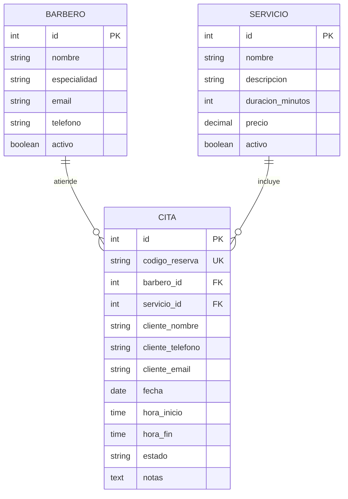

# 📄 Especificación de Requisitos y Criterios de Aceptación

**Proyecto:** BarberShop Pro — Sistema de Gestión y Agendamiento de Barbería  
**Curso:** Ingeniería de Software II (Código 17934) — Cotecnova  
**Versión:** 1.0 (Seguimiento 1)  
**Responsable de Documentación:** Juan David Monroy  
**Revisado por:** Elizabeth Ramirez (Líder Técnico), Juan David Osorio (Calidad)

---

## 1. Introducción y Propósito

El presente documento formaliza los requisitos funcionales, no funcionales y criterios de aceptación para el desarrollo del sistema **BarberShop Pro**. La aplicación tiene como objetivo resolver los problemas operativos comunes en barberías urbanas: pérdidas de turnos por desorganización, doble reserva simultánea de barberos y falta de visibilidad del rendimiento del personal.

---

## 2. Actores del Sistema

| Actor | Descripción |
|---|---|
| **Cliente** | Usuario final que consulta servicios, disponibilidad y agenda o cancela citas. |
| **Barbero** | Profesional que visualiza su agenda diaria y actualiza el estado de atención de los clientes. |
| **Administrador** | Administra el catálogo de servicios, gestiona barberos y supervisa el flujo general de la barbería. |

---

## 3. Modelo de Entidades Principales

---

## 4. Requisitos Funcionales (RF)

### 📌 RF-01: Gestión y Registro de Usuarios / Barberos
* **Prioridad:** Alta (Seguimiento 1)
* **Descripción:** El sistema debe permitir el registro y visualización de los barberos activos que prestan servicio en el local.
* **Criterios de Aceptación:**
  * **CA-01.1:** *Dado* un barbero con datos válidos (nombre, email único, especialidad), *cuando* se registra en el sistema, *entonces* queda almacenado con estado `activo = true`.
  * **CA-01.2:** *Dado* un intento de registro con un email ya existente, *cuando* se envía la petición, *entonces* el sistema rechaza la creación retornando un código `HTTP 400 Bad Request` y un mensaje de error explicativo.

---

### 📌 RF-02: Catálogo y CRUD de Servicios
* **Prioridad:** Alta (Seguimiento 1)
* **Descripción:** Gestión de los servicios ofrecidos en la barbería indicando nombre, descripción, duración en minutos y precio en COP/USD.
* **Criterios de Aceptación:**
  * **CA-02.1:** *Dado* un nuevo servicio con duración > 0 minutos y precio $\ge$ 0, *cuando* se guarda, *entonces* queda disponible en el catálogo de citas.
  * **CA-02.2:** *Dado* un servicio con duración menor o igual a cero (ej. 0 o -15 min), *cuando* se envía la solicitud, *entonces* el sistema debe responder con un error de validación `HTTP 422 Unprocessable Entity`.
  * **CA-02.3:** *Dado* un servicio con precio negativo, *cuando* se intenta registrar, *entonces* el sistema debe rechazarlo impidiendo su persistencia.

---

### 📌 RF-03: Agendamiento de Citas con Cálculo de Horario
* **Prioridad:** Alta (Seguimiento 1)
* **Descripción:** Un cliente puede seleccionar servicio, barbero, fecha y hora de inicio. El sistema calcula automáticamente la `hora_fin` sumando la duración del servicio a la `hora_inicio`.
* **Criterios de Aceptación:**
  * **CA-03.1:** *Dado* un servicio con duración de 45 minutos y una hora de inicio `10:00`, *cuando* se procesa la cita, *entonces* el sistema calcula la hora de fin exactamente a las `10:45`.
  * **CA-03.2:** *Dado* un agendamiento exitoso, *cuando* la cita se almacena, *entonces* se genera un código de reserva único alfanumérico (ej: `BSP-A1B2C3`) y el estado inicial es `Pendiente`.
  * **CA-03.3:** *Dado* un intento de agendamiento en el pasado (fecha y hora menor a la actual), *cuando* se valida la petición, *entonces* el sistema debe rechazarla con error `HTTP 400`.

---

### 📌 RF-04: Prevención Estricta de Choques de Horario (No Solapamiento)
* **Prioridad:** Crítica / Alta (Seguimiento 1)
* **Descripción:** Un barbero no puede tener dos citas que se superpongan en horario el mismo día.
* **Criterios de Aceptación:**
  * **CA-04.1 (Solapamiento total o parcial):** *Dado* que el Barbero 1 ya tiene una cita de `10:00` a `10:30`, *cuando* otro cliente intenta reservar con el mismo barbero de `10:15` a `10:45`, *entonces* el sistema debe rechazar la reserva respondiendo `HTTP 409 Conflict`.
  * **CA-04.2 (Citas contiguas permitidas):** *Dado* que el Barbero 1 tiene una cita de `10:00` a `10:30`, *cuando* un cliente reserva exactamente de `10:30` a `11:00`, *entonces* el sistema debe permitir la reserva satisfactoriamente.
  * **CA-04.3 (Barberos diferentes):** *Dado* que el Barbero 1 está ocupado de `10:00` a `10:30`, *cuando* un cliente agenda a las `10:00` con el Barbero 2, *entonces* la reserva es aprobada.

---

### 📌 RF-05: Cancelación de Cita con Regla de Anticipación
* **Prioridad:** Media (Seguimiento 2)
* **Descripción:** El cliente puede cancelar su cita mediante su código de reserva con una anticipación mínima requerida.
* **Criterios de Aceptación:**
  * **CA-05.1:** *Dado* que faltan más de 2 horas para la cita, *cuando* el cliente solicita cancelación, *entonces* el estado cambia a `Cancelada` y el horario del barbero se libera.
  * **CA-05.2:** *Dado* que faltan menos de 2 horas para la cita, *cuando* el cliente intenta cancelar, *entonces* el sistema deniega la acción informando que el límite de cancelación expiró.

---

### 📌 RF-06: Agenda del Barbero y Transición de Estados
* **Prioridad:** Media (Seguimiento 1 y 2)
* **Descripción:** El barbero puede consultar sus citas asignadas para una fecha específica y modificar su estado operativo (`Pendiente` $\rightarrow$ `En curso` $\rightarrow$ `Finalizada` o `Cancelada`).
* **Criterios de Aceptación:**
  * **CA-06.1:** *Dado* un barbero autenticado/identificado, *cuando* consulta una fecha, *entonces* recibe la lista cronológica de sus citas con los datos del cliente y servicio.
  * **CA-06.2:** *Dado* una cita en estado `Finalizada`, *cuando* se intenta cambiar a otro estado, *entonces* el sistema bloquea la modificación por considerarse un estado terminal.

---

### 📌 RF-07: Notificaciones Externas por Mensajería (Fuera de Alcance)
* **Estado:** **Excluido / Postergado para Versión 2.0**.
* **Justificación:** Se prioriza la robustez de la lógica de concurrencia y cobertura de pruebas antes de introducir dependencias externas de pasarelas SMS/WhatsApp que puedan comprometer la estabilidad evaluativa.

---

### 📌 RF-08 y RF-09: Dashboard de Rendimiento y Calificación
* **Prioridad:** Media (Seguimiento 2 y Entrega Final).
* **Descripción:** Métricas de atención por barbero y evaluación de servicio de 1 a 5 estrellas por parte de clientes atendidos.

---

## 5. Requisitos No Funcionales (RNF)

1. **RNF-01 (Integridad y Consistencia):** La base de datos debe aplicar restricciones de clave foránea (`FOREIGN KEY`) entre Citas, Barberos y Servicios.
2. **RNF-02 (Rendimiento):** El endpoint de consulta de disponibilidad debe resolver los bloques libres/ocupados en menos de 300 ms.
3. **RNF-03 (Mantenibilidad y Arquitectura):** Separación de capas en Backend (Modelos, Esquemas Pydantic, Controladores/Rutas, Repositorios/Servicios).
4. **RNF-04 (Seguridad):** Ausencia total de credenciales y variables de entorno en el control de versiones. Uso estricto de `.env.example` y sanitización de entradas contra inyecciones SQL a través de SQLAlchemy ORM.
