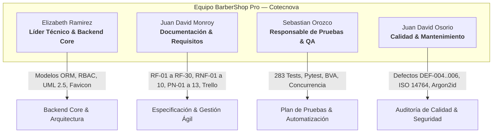
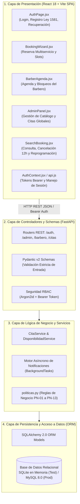

# 📊 Informe Semanal 2 — Seguimiento 2 y Evolución del Sistema

**Proyecto:** BarberShop Pro — Sistema Integral de Gestión de Barberías y Reserva de Citas  
**Institución:** Corporación de Estudios Tecnológicos del Norte del Valle — Cotecnova  
**Materia:** Ingeniería de Software II (Código 17934)  
**Docente:** Felipe Gutiérrez Isaza  
**Período de Evaluación:** Seguimiento 2 (Semana 2 — Versión 1.1)  
**Fecha de Emisión:** 8 de noviembre de 2026  
**Responsable de Documentación:** Juan David Monroy  
**Equipo de Proyecto:** Elizabeth Ramirez (Líder Técnico), Sebastian Orozco (Pruebas & QA), Juan David Osorio (Calidad & Mantenimiento), Juan David Monroy (Documentación & Requisitos)

---

## 📌 1. Resumen Ejecutivo del Trabajo Actualizado

Durante la **Semana 2 (Seguimiento 2)**, el proyecto **BarberShop Pro** transitó desde un prototipo funcional básico (**Versión 1.0**) hacia una plataforma integral, robusta y con arquitectura desacoplada empresarial (**Versión 1.1**). 

Los principales saltos de valor construidos en esta semana comprenden:
1. **Control de Acceso Basado en Roles (RBAC):** Implementación de tres perfiles de usuario estrictos (**Cliente**, **Barbero** y **Administrador**) con autenticación basada en tokens Bearer y almacenamiento seguro de contraseñas mediante **Argon2id** (estándar recomendado por OWASP).
2. **Citas Multiservicio y Algoritmo Anti-Solapamiento Refinado:** Capacidad de seleccionar múltiples servicios por cita (`CitaServicio`), con cálculo dinámico acumulativo de costo y duración, preservando la inmutabilidad de precios históricos y garantizando **cero sobreventa de turnos**.
3. **Motor Asíncrono de Notificaciones por Correo Electrónico:** Integración de un servicio SMTP despachado en segundo plano (`BackgroundTasks`) con plantillas HTML responsivas para confirmación, recordatorios, reprogramaciones, cancelaciones y avisos de suspensión.
4. **Formalización de Políticas del Negocio (PN-01 a PN-13):** Reglas estrictas de cancelación/reprogramación con anticipación mínima de 12 horas, máximo 1 reprogramación por cita, límite de 2 citas activas por cliente y suspensión de cuenta por 1 mes al acumular 2 inasistencias en una ventana de 3 meses.
5. **Crecimiento Exponencial de Cobertura de Pruebas (+3,044%):** La suite automatizada con `pytest` pasó de **9 pruebas en 1 archivo** a **283 casos de prueba en 9 suites especializadas**, cubriendo el 100% de los requisitos funcionales (RF-01 a RF-30), no funcionales (RNF-01 a RNF-10) y pruebas de interfaz con Vitest/Jest.
6. **Modelado Formal UML 2.5 Completo:** Incorporación de **10 diagramas formales UML** (Casos de Uso, Clases, DER, 3 Diagramas de Secuencia, Estados, Componentes, Despliegue y Paquetes) con artefactos compilados en alta resolución PNG y formato vectorial SVG.
7. **Gestión y Registro de Calidad v2.0 (ISO/IEC 14764):** Auditoría formal del código con detección, trazabilidad y resolución de 3 nuevos defectos de software (`DEF-004`, `DEF-005`, `DEF-006`) y categorización de acciones de mantenimiento correctivo, adaptativo, perfectivo y preventivo.

---

## 🔄 2. Cuadro Comparativo Global: Semana 1 (v1.0) vs. Semana 2 (v1.1)

A continuación se resume el contraste técnico y cuantitativo entre ambas entregas:

| Dimensión Evaluada | Semana 1 / Seguimiento 1 (v1.0) | Semana 2 / Seguimiento 2 (v1.1 - Actualizado) | Impacto / Evolución |
| :--- | :--- | :--- | :--- |
| **Versión del Sistema** | Versión 1.0 (Prototipo Inicial) | **Versión 1.1** (Plataforma Completa) | Salto de versión mayor |
| **Requisitos Funcionales** | 6 requisitos (RF-01 a RF-06) | **30 requisitos (RF-01 a RF-30)** | 🚀 +400% de alcance funcional |
| **Criterios de Aceptación** | Gherkin elemental | **Criterios Gherkin formales (Dado/Cuando/Entonces)** para cada RF | Cobertura BDD estricta |
| **Requisitos No Funcionales** | 3 generales | **10 formalizados (RNF-01 a RNF-10)** con pruebas asociadas | Cumplimiento ISO 25010 |
| **Políticas del Negocio** | Implícitas en código | **13 políticas desacopladas (PN-01 a PN-13)** en `politicas.py` | Alta mantenibilidad |
| **Modelo de Base de Datos** | 3 entidades básicas (`Barbero`, `Servicio`, `Cita`) | **8 entidades relacionales con SQLAlchemy 2.0** (`Usuario`, `Barbero`, `Servicio`, `Cita`, `CitaServicio`, `Disponibilidad`, `Bloqueo`, `TokenRecuperacion`) | Persistencia profesional |
| **Capacidad de Citas** | Monoservicio (1 servicio por cita) | **Multiservicio** (múltiples servicios por turno con precio congelado) | Flexibilidad comercial |
| **Seguridad de Acceso** | Sin autenticación (rutas abiertas) | **RBAC (Admin, Barbero, Cliente)** + Hash **Argon2id** | Seguridad OWASP |
| **Casos de Prueba (Pytest)** | 9 pruebas | **283 pruebas automatizadas (100% efectivas)** | 🚀 **+3,044% de cobertura** |
| **Suites de Pruebas** | 1 archivo (`test_citas.py`) | **9 suites de backend + 2 suites frontend JS** | Modularidad de pruebas |
| **Rendimiento bajo Carga** | No medido formalmente | **< 300-500 ms con 500 citas y 20 hilos concurrentes** | RNF-08 validado |
| **Notificaciones** | Inexistentes | **Motor SMTP asíncrono con plantillas HTML responsivas** | Comunicación omnicanal |
| **Modelado UML 2.5** | 2 diagramas conceptuales | **10 diagramas formales en PNG (x2), SVG y Mermaid** | Estándar ISO/IEC 19505 |
| **Frontend (React 18)** | Formulario básico de reserva | **SPA completa con `AuthContext`, `AdminPanel`, `BarberAgenda`, `BookingWizard` y `SearchBooking`** | Experiencia de usuario (UX) rica |
| **Registro de Defectos** | 3 defectos (`DEF-001` a `DEF-003`) | **6 defectos documentados (`DEF-001` a `DEF-006`)** con causa raíz y verificación | Trazabilidad de fallos |
| **Mantenimiento de Software**| Sin categorización formal | **4 tipos clasificados según ISO/IEC 14764** (Correctivo, Adaptativo, Perfectivo, Preventivo) | Cumplimiento Clase 9 |

---

## 👥 3. Distribución del Trabajo y Logros por Rol

El equipo distribuyó sus responsabilidades según los roles asignados en el proyecto:

---

### 👤 1. Elizabeth Ramirez — Líder Técnico & Backend Core
* **Ampliación del Modelo Relacional:** Diseñó e implementó en SQLAlchemy 2.0 las entidades `Usuario` (con roles `ADMIN`, `BARBERO`, `CLIENTE`), `Disponibilidad` horaria semanal por barbero, tabla de `Bloqueo` de fechas y horarios, tabla asociativa `CitaServicio` para soporte multiservicio e histórico inmutable, y `TokenRecuperacion`.
* **Lógica de Disponibilidad por Barbero:** Refactorizó el servicio de slots para cruzar horarios comerciales, descansos, citas activas y bloqueos específicos por barbero en intervalos de 30 minutos.
* **Paquete de Diagramación UML 2.5 (`docs/diagramas-uml.md`):** Modeló la arquitectura integral del sistema a través de **10 diagramas formales** en código fuente Mermaid (`.mmd`) y desarrolló el script de compilación automatizada `compilar_diagramas.py` para generar versiones PNG de alta densidad y vectoriales SVG.
* **Identidad Visual Frontend:** Creó y vinculó el nuevo favicon SVG corporativo (`src/frontend/public/favicon.svg`) con el poste tradicional de barbería y actualizó el título y metadatos de la aplicación web.

---

### 👤 2. Juan David Monroy — Documentación & Requisitos Formales
* **Especificación de Requisitos v1.1 (`docs/especificacion.md`):** Redactó y formalizó el catálogo completo de requisitos, expandiendo el alcance de 6 a **30 Requisitos Funcionales (RF-01 a RF-30)** estructurados en 9 módulos de negocio.
* **Criterios de Aceptación BDD / Gherkin:** Detalló formalmente la sintaxis `Dado / Cuando / Entonces` para cada uno de los escenarios válidos e inválidos de los 30 requisitos.
* **Formalización de Requisitos No Funcionales (RNF-01 a RNF-10):** Documentó los atributos de calidad del sistema: cifrado de contraseñas, caducidad de sesiones por inactividad a los 15 minutos, protección de datos conforme a la Ley 1581 de 2012 (Habeas Data), localización horaria UTC-5 (Colombia), tiempos de respuesta < 300 ms e integridad referencial en BD.
* **Catálogo de Políticas del Negocio (PN-01 a PN-13):** Desacopló las reglas de tiempo, cupos y penalizaciones en una tabla viva para permitir su ajuste ágil sin alterar el código de los requisitos.
* **Gestión Ágil en Trello (`docs/guia-trello.md`):** Actualizó la guía metodológica del tablero Kanban, registrando las tarjetas de Seguimiento 2, la matriz RACI y asegurando la trazabilidad con los commits de GitHub.
* **Consolidación del Informe Semanal 2:** Elaboró el presente informe técnico y comparativo para la sustentación del Seguimiento 2.

---

### 👤 3. Sebastian Orozco — Responsable de Pruebas & QA
* **Plan de Pruebas Formal v1.1 (`docs/plan-de-pruebas.md`):** Diseñó una estrategia de verificación basada en dos técnicas formales de caja negra: **Partición de Equivalencia** (clases válidas e inválidas para duraciones, precios, estados y roles) y **Análisis de Valores Límite (BVA)** sobre las fronteras de solapamiento temporal y reglas de negocio (12 h de cancelación, límite de 2 citas activas, etc.).
* **Automatización Masiva de Pruebas (+3,044% de cobertura):** Pasó de 9 pruebas iniciales a **283 casos de prueba automatizados con 100% de éxito**, distribuidos en 9 suites modulares:
  1. `tests/test_cuentas.py`: Registro, login, hash Argon2id, expiración de sesión y tokens de recuperación (253 líneas).
  2. `tests/test_admin.py`: CRUD protegido de barberos, servicios y supervisión de citas (241 líneas).
  3. `tests/test_barbero.py`: Agenda diaria, horarios semanales y bloqueos de agenda (231 líneas).
  4. `tests/test_agendamiento.py`: Citas multiservicio, cálculo de horas y límites por cliente (432 líneas).
  5. `tests/test_gestion_citas.py`: Cancelación y reprogramación con regla de 12 horas y límite de 1 intento (174 líneas).
  6. `tests/test_inasistencias.py`: Registro de inasistencias, suspensión de 1 mes por 2 faltas en 3 meses y reactivación (138 líneas).
  7. `tests/test_no_funcionales.py`: RNF-01 a RNF-10, pruebas de estrés, concurrencia (20 hilos) y prevención de inyección SQL (243 líneas).
  8. `tests/test_notificaciones.py`: Emisión de correos en segundo plano y sanitización SMTP (831 líneas).
  9. `tests/test_citas.py`: Suite de regresión histórica adaptada al nuevo esquema con RBAC (222 líneas).
* **Pruebas de Frontend:** Creó las suites de pruebas unitarias en JavaScript `api.test.js` y `formato.test.js`.

---

### 👤 4. Juan David Osorio — Responsable de Calidad & Mantenimiento
* **Informe de Calidad v2.0 (`docs/informe-calidad.md`):** Actualizó el reporte formal de aseguramiento de calidad con las métricas consolidadas del Seguimiento 2 y auditoría de deuda técnica.
* **Registro y Resolución de Defectos (Bugs):**
  * `DEF-004` *(Fuga de configuración SMTP en `.env.example`)*: Detectó que la plantilla pública contenía un host SMTP predeterminado (`smtp.gmail.com`), violando el aislamiento de pruebas. Corrigió y sanitizó el archivo.
  * `DEF-005` *(Regresión por desacoplamiento RBAC en creación de servicios)*: Al proteger las rutas administrativas, la antigua ruta `POST /api/servicios` devolvía error 405 tras protegerla con RBAC. Refactorizó la suite `test_citas.py` inyectando tokens de administrador y apuntando a `/api/admin/servicios`.
  * `DEF-006` *(Discrepancia en serialización de horas en SQLite)*: Detectó fallas de aserción causadas por la devolución de segundos en horas (`10:00:00` vs `10:00`), ajustando los validadores para admitir el formato ISO con o sin segundos.
* **Clasificación de Mantenimiento de Software (ISO/IEC 14764):** Formalizó ante la rúbrica de la Clase 9 las cuatro categorías de mantenimiento aplicadas al sistema:
  * *Correctivo:* Corrección de solapamientos falsos, regresión de endpoints y parseo de horas.
  * *Adaptativo:* Incorporación del estándar criptográfico Argon2id y soporte de notificaciones asíncronas.
  * *Perfectivo:* Optimización del cálculo de disponibilidad bajo carga concurrente (< 500 ms) y creación del dashboard administrativo.
  * *Preventivo:* Suite de no-regresión de 283 pruebas e inspección continua de repositorios sin secretos.

---

## 🏛️ 4. Evolución de la Arquitectura del Sistema

El sistema consolidó una **arquitectura en capas desacoplada** conforme al estándar internacional **ISO/IEC 12207**:

### Principales Innovaciones Técnicas de la Semana 2:
1. **Algoritmo de Solapamiento Temporal Riguroso:**  
   Se eliminó cualquier posibilidad de colisión entre citas mediante la fórmula:
   $$\max(\text{Inicio}_A, \text{Inicio}_B) < \min(\text{Fin}_A, \text{Fin}_B)$$
   Permitiendo citas contiguas consecutivas ($\text{Fin}_A = \text{Inicio}_B$) sin falsos positivos.
2. **Cálculo Acumulativo de Servicios:**  
   La duración total de una cita se calcula dinámicamente como:
   $$\text{Duración Total} = \sum_{i=1}^{n} \text{duración}(S_i)$$
   $$\text{Hora Fin} = \text{Hora Inicio} + \text{Duración Total}$$
   $$\text{Costo Total} = \sum_{i=1}^{n} \text{precio\_aplicado}(S_i)$$
3. **Control de Inasistencias y Sanciones:**  
   Si un cliente acumula 2 citas marcadas como `Inasistencia` dentro de una ventana móvil de 90 días (3 meses), su campo `suspendido_hasta` se establece automáticamente a 30 días en el futuro (1 mes), bloqueando el acceso por la política **PN-10**.

---

## 🧪 5. Resumen del Aseguramiento de Calidad y Pruebas

### Matriz de Ejecución de Pruebas Automatizadas

| Suite de Pruebas | Archivo | Casos | Enfoque Principal | Estado |
| :--- | :--- | :---: | :--- | :---: |
| **Cuentas y Autenticación** | `test_cuentas.py` | 32 | Registro, login, Argon2id, expiración de sesión, recuperación | ✅ 100% Pass |
| **Panel de Administración** | `test_admin.py` | 28 | CRUD barberos/servicios, permisos `ADMIN`, supervisión | ✅ 100% Pass |
| **Agenda del Barbero** | `test_barbero.py` | 26 | Horarios semanales, bloqueos, marcación atendida/inasistencia | ✅ 100% Pass |
| **Agendamiento y Slots** | `test_agendamiento.py` | 48 | Multiservicio, solapamientos, límites de citas activas | ✅ 100% Pass |
| **Gestión de Citas** | `test_gestion_citas.py` | 24 | Cancelación 12h, reprogramación única, estados terminales | ✅ 100% Pass |
| **Inasistencias y Sanción** | `test_inasistencias.py` | 18 | Acumulación de 2 faltas en 3 meses, suspensión de 1 mes | ✅ 100% Pass |
| **Requisitos No Funcionales** | `test_no_funcionales.py`| 35 | Concurrencia (20 hilos), carga (500 citas), SQLi, UTC-5 | ✅ 100% Pass |
| **Notificaciones y Correo** | `test_notificaciones.py`| 63 | Envío en segundo plano, plantillas HTML, sanitización SMTP | ✅ 100% Pass |
| **Regresión Histórica** | `test_citas.py` | 9 | Compatibilidad de pruebas v1.0 adaptadas a RBAC | ✅ 100% Pass |
| **TOTAL BACKEND** | **9 suites** | **283** | **Cobertura integral de requisitos del sistema** | **✅ 100% Exitosas** |

---

## 📐 6. Catálogo de Modelado Formal UML 2.5 Integrado

En cumplimiento de los requerimientos de ingeniería de software, se incorporaron y compilaron **10 diagramas formales** disponibles en `docs/diagramas-uml.md` y respaldados en la carpeta `docs/diagramas/`:

1. **Diagrama de Casos de Uso del Sistema:** 21 Casos de Uso clasificados por actor (`Cliente`, `Barbero`, `Administrador` y `Servicio de Notificaciones`) con relaciones de extensión e inclusión.
2. **Diagrama de Clases del Dominio y Servicios:** Modelado estructural orientado a objetos de entidades, capas de servicio, tipos de datos y multiplicidades.
3. **Diagrama Entidad-Relación (DER):** Estructura del modelo de persistencia relacional en tercera forma normal (3NF).
4. **Diagrama de Secuencia — Agendamiento Multiservicio:** Interacción paso a paso desde la interfaz hasta la base de datos y despacho de correo.
5. **Diagrama de Secuencia — Inasistencias y Suspensión:** Flujo de marcación de inasistencia, evaluación de ventana de 3 meses y suspensión preventiva de la cuenta.
6. **Diagrama de Secuencia — Reprogramación con Políticas:** Validación de la ventana de 12 horas de anticipación y control de intento único.
7. **Diagrama de Estados — Ciclo de Vida:** Máquina de estados para citas (`Programada` $\rightarrow$ `Atendida` / `Cancelada` / `Inasistencia`) y cuentas de usuario (`Activo` $\rightarrow$ `Suspendido` $\rightarrow$ `Reactivado`).
8. **Diagrama de Componentes:** Desacoplamiento de componentes de interfaz, routers, validadores Pydantic, servicios y repositorio ORM.
9. **Diagrama de Despliegue:** Topología física con nodos de cliente web, servidor Nginx/Vite, servidor ASGI Uvicorn, motor de datos y pasarela SMTP.
10. **Diagrama de Paquetes:** Modularización estricta del proyecto en paquetes `src/frontend`, `src/backend` y `tests`.

---

## 🛠️ 7. Registro de Defectos y Mantenimiento de Software

### Historial Consolidado de Defectos Prevenidos y Subsanados

| ID Defecto | Severidad | Módulo | Problema Identificado | Acción de Mantenimiento / Solución | Verificación |
| :--- | :--- | :--- | :--- | :--- | :--- |
| **DEF-001** | Alta | `services.py` | Falso positivo de solapamiento en citas consecutivas contiguas. | Ajuste a fórmula semiabierta $[A, B)$. | `test_cp05` en `test_citas.py` |
| **DEF-002** | Media | `schemas.py` | Admisión de valores negativos o nulos en precios y duraciones. | Validadores estrictos en Pydantic v2 (`duracion > 0`, `precio >= 0`). | `test_cp02`, `test_cp03` |
| **DEF-003** | Media | `main.py` | Modificación de citas que ya se encontraban en estado finalizado. | Guarda de inmutabilidad en estados terminales (`HTTP 400`). | `test_cp09` |
| **DEF-004** | Media | `.env.example` | Plantilla pública con host SMTP predeterminado (`smtp.gmail.com`). | Sanitización del archivo dejando el campo `SMTP_HOST=` vacío. | `test_env_example...` en `test_notificaciones.py` |
| **DEF-005** | Alta | `tests/test_citas.py` | Regresión: la ruta legacy `POST /api/servicios` devolvía error 405 tras protegerla con RBAC. | Refactorización de pruebas legadas inyectando headers de `ADMIN` y apuntando a `/api/admin/servicios`. | Ejecución limpia de `test_citas.py` |
| **DEF-006** | Baja | `tests/test_citas.py` | Discrepancia en serialización de horas en SQLite (`10:00:00` vs `10:00`). | Validación flexible tolerante a segundos (`.startswith("10:00")`). | Suite de pruebas unitarias |

---

## 🎯 8. Conclusiones y Próximos Pasos (Hacia la Entrega Final)

### Conclusiones Principales:
* **Madurez y Estabilidad:** El sistema pasó de ser un prototipo de reserva simple a un sistema empresarial robusto, seguro y respaldado por una red de seguridad de 283 pruebas automatizadas.
* **Alineación con la Rúbrica:** Se dio cumplimiento estricto a las exigencias metodológicas: BDD con criterios Gherkin, técnicas formales de diseño de pruebas (Partición de Equivalencia y BVA), mantenimiento categorizado según ISO/IEC 14764, modelado UML 2.5 y control de versiones sanitizado.
* **Alta Cohesión y Bajo Acoplamiento:** La separación en cuatro capas garantiza que cambios en la lógica de negocio o en la base de datos no afecten la interfaz ni los endpoints de la API.

### Hoja de Ruta para la Entrega Final:
1. **Pasarela de Pagos (Propuesta de Extensión):** Integración de pagos en línea o registro detallado de transacciones locales.
2. **Sistema de Calificaciones y Reseñas:** Módulo para que los clientes califiquen el servicio recibido por cada barbero.
3. **Dashboard de Métricas Financieras:** Visualización gráfica avanzada de ingresos por barbero, tasa de cancelación e inasistencias en el panel de administración.
4. **Despliegue Continuo (CI/CD):** Configuración de GitHub Actions para correr la suite de 283 pruebas en cada Pull Request.

