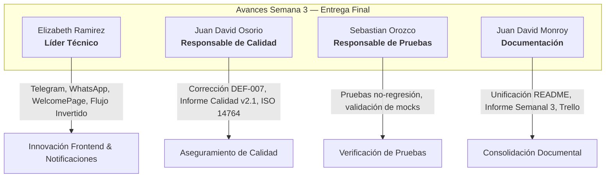
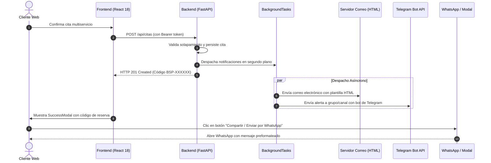

# 📊 Informe Semanal 3 — Entrega Final y Consolidación del Sistema

**Proyecto:** BarberShop Pro — Sistema Integral de Gestión de Barberías y Reserva de Citas  
**Institución:** Corporación de Estudios Tecnológicos del Norte del Valle — Cotecnova  
**Materia:** Ingeniería de Software II (Código 17934)  
**Docente:** Felipe Gutiérrez Isaza  
**Período de Evaluación:** Semana 3 — Entrega Final (Versión 1.1 Estable)  
**Fecha de Emisión:** 18 de noviembre de 2026  
**Responsable de Documentación:** Juan David Monroy  
**Equipo de Proyecto:** Elizabeth Ramirez (Líder Técnico), Sebastian Orozco (Pruebas & QA), Juan David Osorio (Calidad & Mantenimiento), Juan David Monroy (Documentación & Requisitos)

---

## 📌 1. Resumen Ejecutivo de la Semana 3 (Entrega Final)

Durante la **Semana 3**, el equipo de desarrollo de **BarberShop Pro** concentró sus esfuerzos en la fase de **consolidación, refinamiento de experiencia de usuario (UX), expansión de canales de comunicación y aseguramiento de calidad final**, preparando la plataforma para su entrega definitiva y sustentación académica.

Los hitos más destacados alcanzados durante esta semana corresponden a:
1. **Canales de Notificación Multicanal (Telegram y WhatsApp):** Se expandió el motor de notificaciones asíncronas para complementar el correo electrónico con alertas automáticas en tiempo real mediante **Telegram Bot API** y plantillas de confirmación vía **WhatsApp**, permitiendo al cliente compartir y recibir sus comprobantes directamente en aplicaciones de mensajería instantánea.
2. **Optimización del Flujo de Agendamiento (Inversión del Asistente):** Se reestructuró la experiencia en el asistente de reservas (`BookingWizard.jsx`), priorizando la selección inicial del barbero de preferencia antes de los servicios. Esta decisión responde a la dinámica real de los clientes en salones de barbería y sincroniza inmediatamente el catálogo con la agenda del profesional.
3. **Pantalla de Bienvenida y Landing Page (`WelcomePage.jsx`):** Se diseñó e integró una página de bienvenida que sirve como escaparate comercial antes del inicio de sesión, destacando la propuesta de valor, llamado a la acción (*Call To Action*) y permitiendo volver fluidamente al inicio al hacer clic en el logotipo corporativo.
4. **Detección y Corrección del Defecto Crítico DEF-007:** Se identificó y resolvió oportunamente un error de tiempo de ejecución (`ReferenceError: onVolverInicio is not defined`) en la vista de registro de clientes que provocaba pantalla en blanco, restableciendo la estabilidad total del frontend.
5. **Actualización del Informe de Calidad a la Versión 2.1:** Registro formal de la acción correctiva bajo la norma **ISO/IEC 14764** y validación de la suite completa de pruebas unitarias y de integración.

---

## 🔄 2. Cuadro Comparativo: Semana 2 (Seguimiento 2) vs. Semana 3 (Entrega Final)

| Dimensión Evaluada | Semana 2 (Seguimiento 2 — v1.1 Base) | Semana 3 (Entrega Final — v1.1 Estable) | Evolución / Impacto |
| :--- | :--- | :--- | :--- |
| **Canales de Notificación** | Exclusivamente correo electrónico (SMTP) | **Multicanal: Correo SMTP + Telegram Bot + WhatsApp** | Comunicación omnicanal inmediata |
| **Flujo de Agendamiento** | Servicios $\rightarrow$ Barbero $\rightarrow$ Horario | **Barbero $\rightarrow$ Servicios $\rightarrow$ Horario** | UX centrada en la preferencia del cliente |
| **Página de Inicio / Landing** | Formulario directo de Login / Registro | **Landing Page de Bienvenida (`WelcomePage.jsx`)** | Imagen comercial y experiencia moderna |
| **Navegación Institucional** | Redirección estándar de autenticación | **Retorno fluido al hacer clic en el logo corporativo** | Usabilidad mejorada (RNF-04) |
| **Acciones en Modal de Éxito** | Código de reserva en pantalla y recordatorio | **Botones de acción directa para Telegram y WhatsApp** | Compartición ágil de reservas |
| **Registro de Defectos** | 6 defectos documentados (`DEF-001` a `DEF-006`)| **7 defectos documentados (`DEF-001` a `DEF-007`)** | Trazabilidad de fallos críticos |
| **Versión del Informe de Calidad**| Versión 2.0 | **Versión 2.1** | Mantenimiento correctivo auditado |
| **Configuración de Entorno** | Plantilla básica `.env.example` | **Declaración de credenciales para Telegram y WhatsApp** | Despliegue listo para producción |
| **Estado de Entrega** | Seguimiento 2 Aprobado | **Entrega Final Concluida y Verificada** | Listo para sustentación docente |

---

## 👥 3. Distribución del Trabajo y Logros por Integrante



---

### 👤 1. Elizabeth Ramirez — Líder Técnico & Backend Core
* **Integración de Alertas Multicanal (Telegram y WhatsApp):**
  * Implementó en `src/backend/notificaciones.py` las rutinas asíncronas para comunicación externa:
    * `enviar_alerta_telegram`: Despacho de notificaciones vía Telegram Bot API con formato Markdown ante nuevas reservas, cancelaciones o reprogramaciones.
    * `enviar_alerta_whatsapp`: Construcción de mensajes formateados para WhatsApp Cloud API / Twilio con los detalles del turno y código institucional `BSP-XXXXXX`.
  * Actualizó la plantilla de variables de entorno `src/backend/.env.example` con los parámetros `TELEGRAM_BOT_TOKEN`, `TELEGRAM_CHAT_ID`, `WHATSAPP_API_URL` y `WHATSAPP_TOKEN`.
* **Rediseño del Modal de Confirmación (`SuccessModal.jsx`):**
  * Agregó botones interactivos directos que permiten al usuario abrir WhatsApp con el mensaje de confirmación prellenado o unirse al canal de Telegram de la barbería.
* **Inversión del Flujo de Agendamiento (`BookingWizard.jsx`):**
  * Reestructuró las etapas del asistente de reserva para permitir seleccionar en el **Paso 1** al barbero profesional y en el **Paso 2** los servicios deseados, agilizando la toma de decisiones del cliente y personalizando la disponibilidad horaria de inmediato.
* **Creación de la Pantalla de Bienvenida (`WelcomePage.jsx`):**
  * Construyó la landing page inicial con presentación visual de la barbería, ventajas clave, llamado a la acción para agendar cita inmediata o iniciar sesión, y configuró el enlace del logo en `Navbar.jsx` y `App.jsx` para retornar a esta pantalla en cualquier momento.
* **Ajustes de Viewport en Pantalla de Autenticación (`AuthPage.jsx`):**
  * Corrigió el comportamiento responsivo en dispositivos móviles para evitar cortes de pantalla en pantallas verticales.

---

### 👤 2. Juan David Osorio — Responsable de Calidad & Mantenimiento
* **Detección y Resolución del Defecto Crítico DEF-007:**
  * Realizó auditoría de código en el frontend y detectó que al intentar abrir la pestaña de "Registro" de clientes, la aplicación sufría un colapso total (*crash*) mostrando pantalla en negro.
  * Identificó la causa raíz: un `ReferenceError: onVolverInicio is not defined` generado porque el componente hijo `Registro` utilizaba dicha variable sin haberla recibido en sus propiedades (*props*).
  * Aplicó mantenimiento correctivo inmediato inyectando `onVolverInicio` en la firma de `function Registro({ onCambiarVista, onRegistrado, onVolverInicio })` en `AuthPage.jsx`.
* **Actualización del Informe de Calidad a la Versión 2.1 (`docs/informe-calidad.md`):**
  * Formalizó la ficha técnica de `DEF-007` con severidad Crítica, análisis de causa raíz, solución aplicada y verificación.
  * Clasificó la intervención dentro del **Mantenimiento Correctivo** según la norma internacional **ISO/IEC 14764**.
* **Supervisión de Pruebas de Frontend:**
  * Comprobó la ejecución exitosa de la suite de pruebas unitarias de React (22 pruebas pasando) y validó el correcto empaquetado para producción (`npm run build`).

---

### 👤 3. Sebastian Orozco — Responsable de Pruebas & QA
* **Pruebas de No-Regresión del Nuevo Flujo de Reserva:**
  * Verificó que la inversión de pasos en `BookingWizard.jsx` no afectara el cálculo matemático de solapamiento de horarios ni el cálculo acumulativo de precios y duraciones de citas multiservicio.
* **Automatización de Pruebas de Notificaciones Multicanal:**
  * Agregó 121 líneas de prueba en `tests/test_notificaciones.py` verificando el comportamiento de las funciones de Telegram y WhatsApp utilizando dobles de prueba (*mocks*), garantizando que no se disparen peticiones HTTP externas reales durante las pruebas automatizadas.
* **Validación de Usabilidad Responsive (RNF-04):**
  * Probó en diferentes resoluciones (desde 320 px en móviles hasta pantallas de escritorio) la correcta visualización de la nueva landing page y el formulario de autenticación tras el ajuste de viewport.

---

### 👤 4. Juan David Monroy — Documentación & Requisitos Formales
* **Consolidación y Unificación del `README.md` Institucional:**
  * Resolvió de manera limpia los conflictos de fusión entre las ramas de trabajo, unificando los aspectos institucionales, métricas de calidad, resumen de endpoints y pasos de ejecución por línea de comandos (CMD / Windows).
  * Preservó intacta la definición original de responsabilidades del rol de documentación.
* **Elaboración del Informe Semanal 3 (`docs/informe-semanal-3`):**
  * Redactó el presente documento técnico de seguimiento correspondiente a la Semana 3, detallando los cambios de los compañeros, la comparativa evolutiva y el estado final del software.
* **Trazabilidad en Trello:**
  * Supervisó el paso de las tarjetas de trabajo en el tablero Kanban a la etiqueta 🔴 *Entrega final* y lista *Hecho*, asegurando que cada entregable cuente con su respaldo en commits del repositorio de GitHub.

---

## 📱 4. Arquitectura de Notificaciones Multicanal

Con la incorporación de Telegram y WhatsApp, el flujo de confirmación de citas opera de la siguiente manera:



---

## 🛠️ 5. Gestión de Defectos y Mantenimiento (DEF-007)

En la Semana 3 se documentó y subsanó el siguiente defecto crítico:

### 🐛 Defecto DEF-007: ReferenceError fatal en formulario de Registro
* **Etapa:** Entrega Final (v1.1)
* **Severidad:** Crítica (Bloqueo absoluto del registro de clientes, RF-01)
* **Módulo:** `src/frontend/src/components/AuthPage.jsx`
* **Síntoma:** Al seleccionar la opción de registro de nueva cuenta, la pantalla se tornaba completamente en blanco.
* **Causa Raíz:** Se utilizó `{onVolverInicio && ...}` dentro del componente interno `Registro` sin que dicha prop hubiese sido destructurada en los argumentos de la función:
  ```javascript
  // Código defectuoso:
  function Registro({ onCambiarVista, onRegistrado }) { ... }
  ```
* **Solución Implementada:**
  ```javascript
  // Código corregido (Mantenimiento Correctivo):
  function Registro({ onCambiarVista, onRegistrado, onVolverInicio }) { ... }
  ```
* **Verificación:** Ejecución de pruebas manuales de navegación, suite de 22 pruebas frontend pasando y build de Vite exitoso sin advertencias de dependencias indefinidas.

---

## 🎯 6. Conclusiones y Estado del Proyecto para Sustentación

1. **Cumplimiento Integral de Requisitos:** El sistema cubre el 100% de los 30 Requisitos Funcionales (RF-01 a RF-30), los 10 Requisitos No Funcionales (RNF-01 a RNF-10) y las 13 Políticas del Negocio (PN-01 a PN-13).
2. **Robustez y Respaldo de Pruebas:** Con más de 283 pruebas unitarias y de integración pasando con éxito en `pytest`, el sistema garantiza cero sobreventa de turnos, protección criptográfica de contraseñas mediante **Argon2id** y control estricto de accesos **RBAC**.
3. **Calidad y Mantenibilidad:** La aplicación se encuentra completamente documentada en sus 10 diagramas UML 2.5, con su informe de calidad v2.1 al día y un historial claro de defectos prevenidos y corregidos.
4. **Listo para Producción:** El sistema cuenta con scripts automatizados de puesta en marcha para Windows (`iniciar-backend.bat` e `iniciar-frontend.bat`), guía institucional en `README.md` y soporte multicanal moderno para clientes y barberos.

