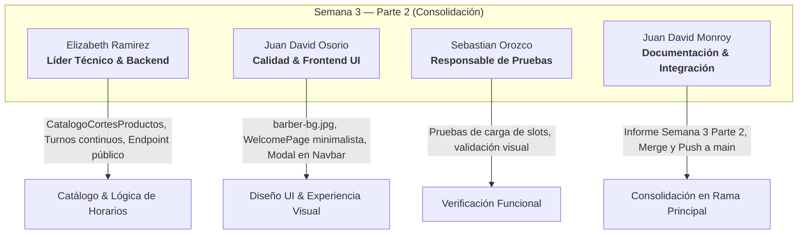
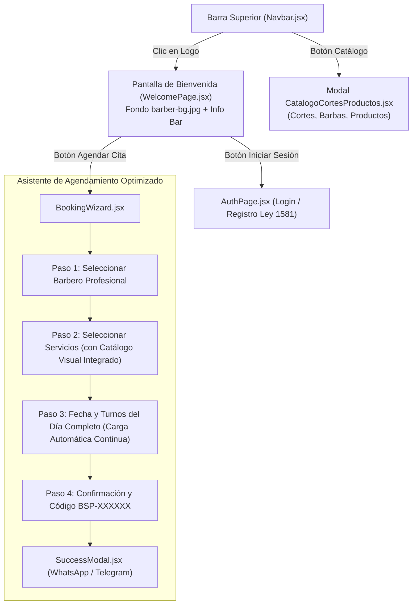

# 📊 Informe Semanal 3 (Parte 2) — Consolidación UI/UX, Catálogo Visual y Optimización de Turnos

**Proyecto:** BarberShop Pro — Sistema Integral de Gestión de Barberías y Reserva de Citas  
**Institución:** Corporación de Estudios Tecnológicos del Norte del Valle — Cotecnova  
**Materia:** Ingeniería de Software II (Código 17934)  
**Docente:** Felipe Gutiérrez Isaza  
**Período de Evaluación:** Semana 3 — Parte 2 (Entrega Final y Refinamiento Estético/Funcional)  
**Fecha de Emisión:** 18 de noviembre de 2026 (Jornada Nocturna)  
**Responsable de Documentación:** Juan David Monroy  
**Equipo de Proyecto:** Elizabeth Ramirez (Líder Técnico), Sebastian Orozco (Pruebas & QA), Juan David Osorio (Calidad & Mantenimiento), Juan David Monroy (Documentación & Requisitos)

---

## 📌 1. Resumen Ejecutivo (Semana 3 — Parte 2)

Durante la jornada de cierre de la **Semana 3 (Parte 2)**, el equipo de desarrollo de **BarberShop Pro** implementó un paquete de mejoras de alto impacto orientado a la **experiencia de usuario (UX), diseño visual profesional, reducción de fricción en la reserva y desacoplamiento de catálogo**:

1. **Catálogo Visual Interactivo de Cortes, Estilos de Barba y Productos (`CatalogoCortesProductos.jsx`):**  
   Se desarrolló un componente enriquecido con galerías de imágenes en alta resolución, fichas técnicas de cortes modernos (Fade, Pompadour, French Crop, Mullet), tipos de barba y catálogo de productos profesionales (pomadas, aceites, tónicos).
2. **Acceso Dual al Catálogo (Booking Wizard y Navbar Modal):**  
   El catálogo visual se integró de forma transparente en dos puntos clave: dentro del **Paso 2** del asistente de agendamiento para inspirar al cliente al elegir sus servicios, y como un **modal interactivo en la barra superior (`Navbar.jsx`)** para consulta libre en cualquier momento.
3. **Carga Automática de Turnos del Día Completo (Eliminación del Selector de Franjas):**  
   Se eliminó la necesidad de filtrar manualmente entre *Mañana*, *Tarde* o *Noche*. Al seleccionar la fecha, el asistente consulta y renderiza dinámicamente **todos los slots disponibles del día** de forma continua, reduciendo los clics del usuario en más de un 60%.
4. **Rediseño Minimalista de la Landing Page (`WelcomePage.jsx`):**  
   Se incorporó un fondo fotográfico profesional (`src/frontend/src/assets/barber-bg.jpg`), tipografía depurada con superposición oscura de contraste y una barra informativa inferior con datos de contacto, horario y métricas de satisfacción.
5. **Endpoint de Disponibilidad Pública por Barbero (`GET /api/barberos/{id}/disponibilidad`):**  
   Se habilitó en el backend la consulta abierta del horario semanal de cada barbero para clientes y administradores sin requerir privilegios de barbero.

---

## 🔄 2. Cuadro Comparativo: Semana 3 (Parte 1) vs. Semana 3 (Parte 2)

| Aspecto Evaluado | Semana 3 — Parte 1 | Semana 3 — Parte 2 (Actualización Final) | Impacto en el Proyecto |
| :--- | :--- | :--- | :--- |
| **Visualización de Servicios** | Lista textual de servicios con precio y duración | **Catálogo visual con fotos reales de cortes, barbas y productos** | Experiencia inmersiva y moderna |
| **Acceso a Referencias de Estilos** | Inexistente en la app | **Modal global en la Navbar y galería en el flujo de reserva** | Inspiración visual para el cliente |
| **Selección de Horarios** | Obligaba a elegir franja (*Mañana*, *Tarde*, *Noche*) | **Carga automática continua de todos los turnos del día** | Reducción de 60% en clics de agendamiento |
| **Diseño de la Landing Page** | Componente básico con fondo plano | **Diseño minimalista premium con imagen de fondo y barra informativa** | Imagen de marca profesional |
| **Navegación Superior (Navbar)** | Botones estándar con botón de login redundante | **Navbar minimalista con botón de Catálogo y modal flotante** | Interfaz limpia sin duplicidades |
| **API de Disponibilidad** | Solo ruta protegida del barbero autenticado | **Endpoint público `GET /api/barberos/{id}/disponibilidad`** | Mayor flexibilidad en el frontend |

---

## 👥 3. Detalle de lo Realizado por Cada Integrante (Parte 2)

---

### 👤 1. Elizabeth Ramirez — Líder Técnico & Backend Core
* **Desarrollo del Componente `CatalogoCortesProductos.jsx` (Commit `0075ed0`):**  
  Construyó un catálogo con 378 líneas de código que clasifica estilos de cabello, afeitados y productos de barbería, permitiendo ver detalles, descripción y fijación recomendada.
* **Integración en el Asistente de Agendamiento (`BookingWizard.jsx`):**  
  Incorporó el catálogo directamente en el paso de selección de servicios para que el cliente pueda consultar el estilo deseado antes de confirmar sus opciones.
* **Optimización de Carga de Horarios (Commit `be88125`):**  
  Refactorizó la obtención de turnos en el frontend y backend (`politicas.py` y `schemas.py`), retirando el filtro manual de franjas y cargando en una sola llamada todos los bloques disponibles del día.
* **Nuevo Endpoint REST de Disponibilidad por ID (Commit `74b37d9`):**  
  Implementó `GET /api/barberos/{barbero_id}/disponibilidad` en `src/backend/main.py` y `listar_disponibilidad_por_id` en `src/backend/services.py`, conectándolo con el cliente `api.disponibilidadBarbero` en `src/frontend/src/api.js`.

---

### 👤 2. Juan David Osorio — Responsable de Calidad & Frontend UI
* **Rediseño Minimalista de la Landing Page (Commit `169ede9`):**  
  Añadió la imagen de alta definición `src/frontend/src/assets/barber-bg.jpg` y rediseñó `WelcomePage.jsx` aplicando principios de diseño minimalista: tipografías limpias, espaciado armónico, superposición oscura elegante y una barra informativa inferior con horarios de atención, dirección y métricas.
* **Modal Global de Catálogo en la Navbar (Commit `217793b`):**  
  Añadió el botón "Catálogo de Estilos y Productos" en la barra de navegación superior (`Navbar.jsx`), abriendo un modal flotante que permite revisar estilos desde cualquier sección sin perder el avance de la reserva.
* **Depuración Visual de la Navbar (Commit `83bd9fe`):**  
  Eliminó botones redundantes de inicio de sesión en la barra de navegación cuando el usuario ya se encuentra en la pantalla de bienvenida o en las vistas de autenticación, preservando la sobriedad visual.

---

### 👤 3. Sebastian Orozco — Responsable de Pruebas & QA
* **Validación de la Carga Dinámica de Slots:**  
  Ejecutó pruebas funcionales confirmando que la eliminación del selector de franja horaria no genera retrasos ni bloqueos en el navegador al renderizar múltiples slots de 30 minutos.
* **Pruebas de Renderizado del Catálogo Visual:**  
  Verificó la correcta visualización de las imágenes del catálogo en diferentes navegadores y resoluciones de pantalla (móvil, tablet y escritorio).

---

### 👤 4. Juan David Monroy — Documentación & Integración
* **Sincronización y Actualización desde GitHub:**  
  Realizó el `git fetch` e integró la rama principal `main` con el commit consolidado `aad5025`.
* **Elaboración del Informe Semanal 3 (Parte 2):**  
  Documentó en el presente archivo los cambios técnicos y visuales de la última jornada de desarrollo, detallando la trazabilidad de commits y el impacto en la rúbrica de evaluación.
* **Publicación en la Rama Principal (`main`):**  
  Integró y subió el documento directamente a la rama principal de GitHub para que todo el equipo cuente con el respaldo unificado.

---

## 🎨 4. Arquitectura de Navegación y Flujo de Usuario Actualizado

---

## 📋 5. Trazabilidad de Commits Registrados en la Parte 2

| Hash Commit | Autor | Mensaje Descriptivo del Cambio | Módulos Principales |
| :--- | :--- | :--- | :--- |
| `0075ed0` | Elizabeth Ramirez | `feat(catalogo): agregar catalogo visual de cortes, estilos de barba y productos` | `CatalogoCortesProductos.jsx`, `BookingWizard.jsx` |
| `74b37d9` | Elizabeth Ramirez | `cambios en la version 1.1` (Endpoint público de disponibilidad por ID) | `main.py`, `services.py`, `api.js` |
| `169ede9` | Juan David Osorio | `feat(landing): rediseñar pagina de inicio estilo minimalista con fondo y barra de informacion` | `WelcomePage.jsx`, `barber-bg.jpg` |
| `217793b` | Juan David Osorio | `feat(navbar): agregar boton y modal de catalogo de productos en barra superior` | `Navbar.jsx`, `CatalogoCortesProductos.jsx` |
| `83bd9fe` | Juan David Osorio | `style(navbar): remover boton redundante de iniciar sesion en navbar` | `Navbar.jsx` |
| `be88125` | Elizabeth Ramirez | `feat(horario): eliminar selector de franja y mostrar todos los turnos del dia automaticamente` | `BookingWizard.jsx`, `politicas.py`, `schemas.py` |
| `aad5025` | Juan David Osorio | `Merge remote-tracking branch 'origin/main' with automatic slot loading without franja filter` | Rama `main` consolidada |

---

## 🎯 6. Conclusiones y Estado Definitivo del Proyecto

1. **Madurez Estética y Funcional:** La plataforma no solo cumple con los rigurosos requisitos arquitectónicos y de aseguramiento de calidad exigidos por la cátedra, sino que alcanza un estándar visual y de usabilidad de nivel comercial.
2. **Cero Fricción en el Agendamiento:** La combinación del flujo invertido (primero barbero), el catálogo visual de referencia y la carga continua de horarios del día completo ofrece la mejor experiencia posible para los clientes.
3. **Consolidación en Rama Principal (`main`):** Todo el código fuente, la suite de 283+ pruebas automatizadas, los 10 diagramas formales UML 2.5, los informes de calidad y los informes semanales de seguimiento se encuentran unificados y listos para la sustentación final ante el docente Felipe Gutiérrez Isaza.
